<div align="center">

<picture>
  <source media="(prefers-color-scheme: dark)" srcset="docs/assets/banner-dark.svg">
  
</picture>

<br>

[](CHANGELOG.md)
[](LICENSE)
[](https://github.com/CBFerrum/Ferrum)


### Accounting, selling, buying, stock and manufacturing on one append-only ledger you run yourself.

For small and mid-sized companies, groups of companies and the people who keep their books, in any
country an add-on covers. It replaces a separate accounting package, inventory tool and MRP spreadsheet,
and it is the engine Ferrum's Point of Sale, Commerce, Assets, HR, CRM and Field Service post through.

[💡 Why](#-why-ferrum-erp) · [📸 Screenshots](#-screenshots) · [✨ Features](#-features) · [📊 Compare](#-how-it-compares) · [📍 Roadmap](#-roadmap) · [🚀 Install](#-install) · [🔧 Develop](#-develop)

</div>

---

## 💡 Why Ferrum ERP

- 📒 **A ledger that never forgets.** Every posting lands in one universal journal that PostgreSQL itself keeps
  append-only, balanced at commit, locked by period and partitioned by year. A mistake is reversed, never
  edited. Stock moves through an append-only ledger too, valued once when it posts, so a backdated entry never
  sets off a chain of re-valuations.
- 🔗 **One data set with the rest of Ferrum.** Customers, suppliers and items are the platform's shared
  records. The till, the web shop, payroll, fixed assets, CRM quotations and field jobs post through ERP's
  engine, so there is nothing to sync and one set of books.
- 🌍 **Every country is an add-on.** The engine names no country. 26 countries plug into one localization
  seam (taxes, e-invoices, returns, registrations, numbering), only for the companies of that country, so one
  workspace can keep companies in India, Germany and the United States side by side.
- 🧩 **Grows by add-ons and configuration.** Finance, Procurement, Stock Operations, Manufacturing Operations,
  Quality, Warehouse Management and Manufacturing Execution install when a company needs them. Approvals,
  numbering series, tax returns, withholding, carriers and print layouts are records you edit, and every
  entity can be extended in Studio without a release.
- 🏠 **Yours to run.** Open source under the AGPL, compiled into your own Ferrum server, with your data in your
  own PostgreSQL. No per-user licence, no lock-in to a vendor's cloud.
- 🤖 **Every record has an API.** REST and MCP for every entity, under the same permissions, row-level
  security and audit trail as people, so integrations and AI agents work by the same rules. The assistant in
  ERP's pages knows how its documents and reports work.
- 🧮 **Exact money, everywhere.** Decimal arithmetic only. One pure pricing crate prices a basket on the
  server and, built to WebAssembly, on a till that is offline, to the same cent.

## 🎯 At a glance

| | |
|---|---|
| 📦 **Version** | `0.26.3`; each add-on carries its own version, given in [Features](#-features) |
| 🖥️ **Kind** | Own interface at `/erp/` (home, accountant's screens and eight desks); every other record in Ferrum's records frame; two portal pages |
| 🧱 **What it adds** | 5 packages (accounting, selling, buying, inventory, manufacturing) with 40 entities and 37 line tables, 10 roles, 23 reports, 9 print layouts, 5 document templates, 7 menus and 2 events |
| ➕ **Add-ons** | 7 for operations and finance (58 more entities, 23 more reports) and 26 country add-ons, all in this repository |
| 🔗 **Depends on** | Ferrum platform `>=0.3.6, <0.4` (its shared core, parties, products and project records) |
| 🤝 **Works with** | Point of Sale, Commerce, CRM, HR, Assets, Field Service and Bookings, which post through its engine; Operations, which carries the warehouse's and shop floor's devices |
| 🗣️ **Languages** | English, Arabic and Hindi; pages mirror right to left |
| 🧪 **Tests** | 222 Rust tests (71 in the app, 151 in its add-ons) against a real PostgreSQL, 202 interface tests |
| 📄 **Licence** | AGPL-3.0-or-later; the Finance, Procurement, Stock Operations, Manufacturing Operations, Quality, Warehouse and Shop Floor add-ons AGPL-3.0-only |

## 📸 Screenshots

<picture>
  <source media="(prefers-color-scheme: dark)" srcset="docs/assets/screens/erp-home-dark.webp">
  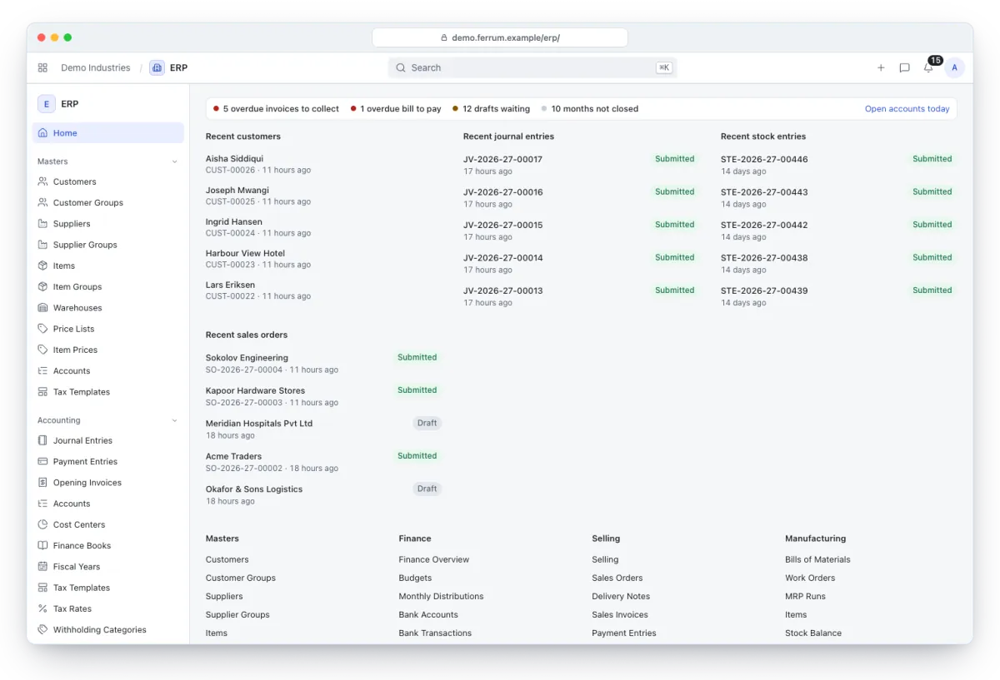
</picture>
<p align="center"><b>🏠 ERP's home</b><br><sub>What needs the books today (overdue invoices and bills, drafts waiting, months not closed), recent records, and every module and add-on.</sub></p>

<table>
<tr>
<td width="50%" valign="top">
<picture><source media="(prefers-color-scheme: dark)" srcset="docs/assets/screens/erp-sales-order-new-dark.webp">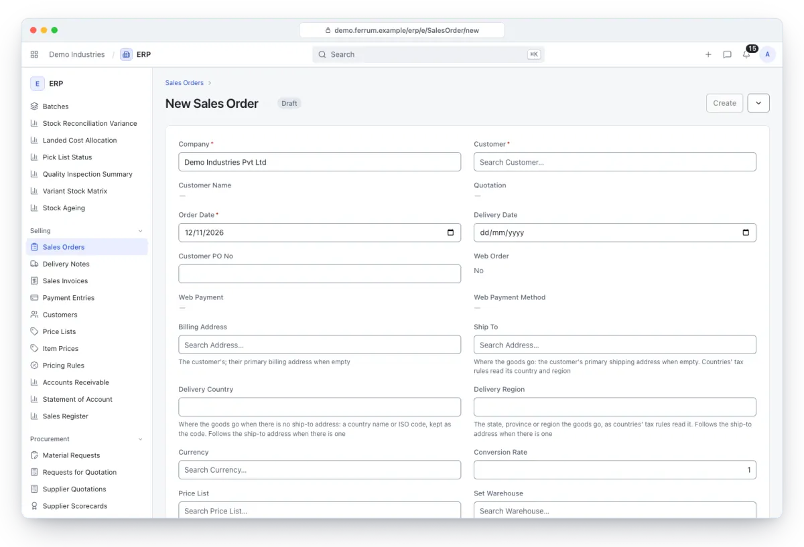</picture>
<p><b>🧾 New sales order</b><br><sub>Start an order by choosing a customer and adding items; prices, rules and taxes fill in.</sub></p>
</td>
<td width="50%" valign="top">
<picture><source media="(prefers-color-scheme: dark)" srcset="docs/assets/screens/erp-sales-order-line-items-dark.webp">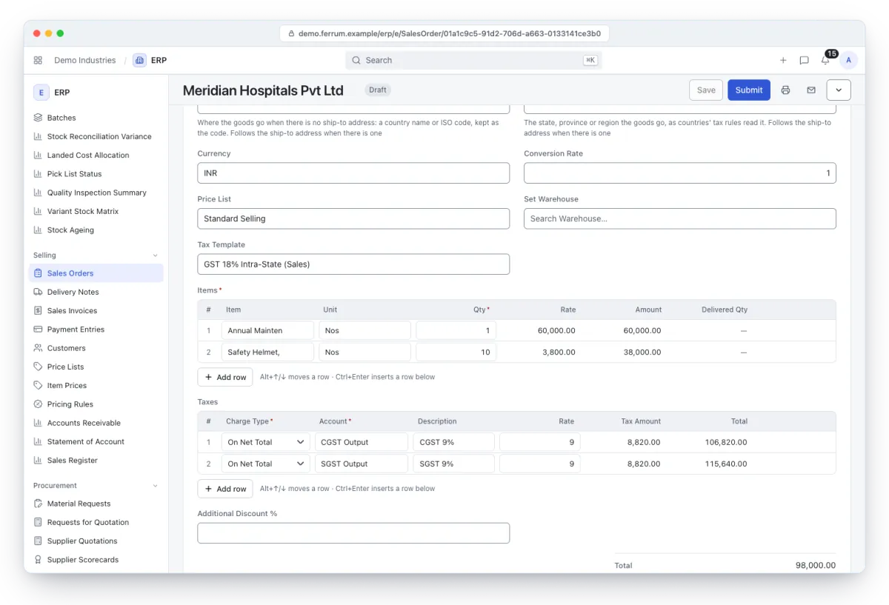</picture>
<p><b>📋 Order lines and taxes</b><br><sub>Review the lines, discounts and tax rows of an order before submitting it.</sub></p>
</td>
</tr>
<tr>
<td width="50%" valign="top">
<picture><source media="(prefers-color-scheme: dark)" srcset="docs/assets/screens/erp-sales-order-submitted-dark.webp">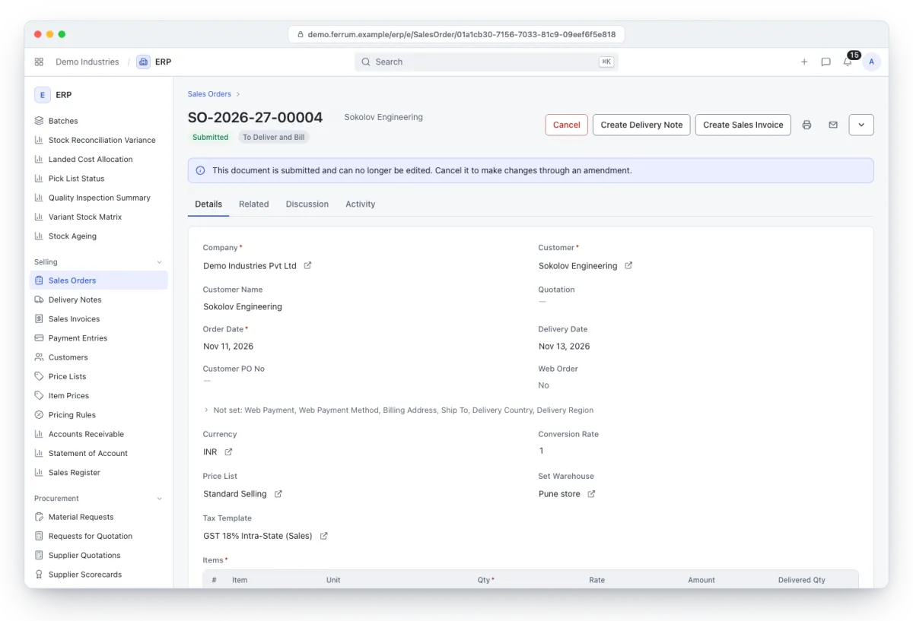</picture>
<p><b>✅ Submitted sales order</b><br><sub>Make the delivery note or the invoice from it, change its items, reserve stock or close it.</sub></p>
</td>
<td width="50%" valign="top">
<picture><source media="(prefers-color-scheme: dark)" srcset="docs/assets/screens/erp-sales-invoice-submitted-dark.webp">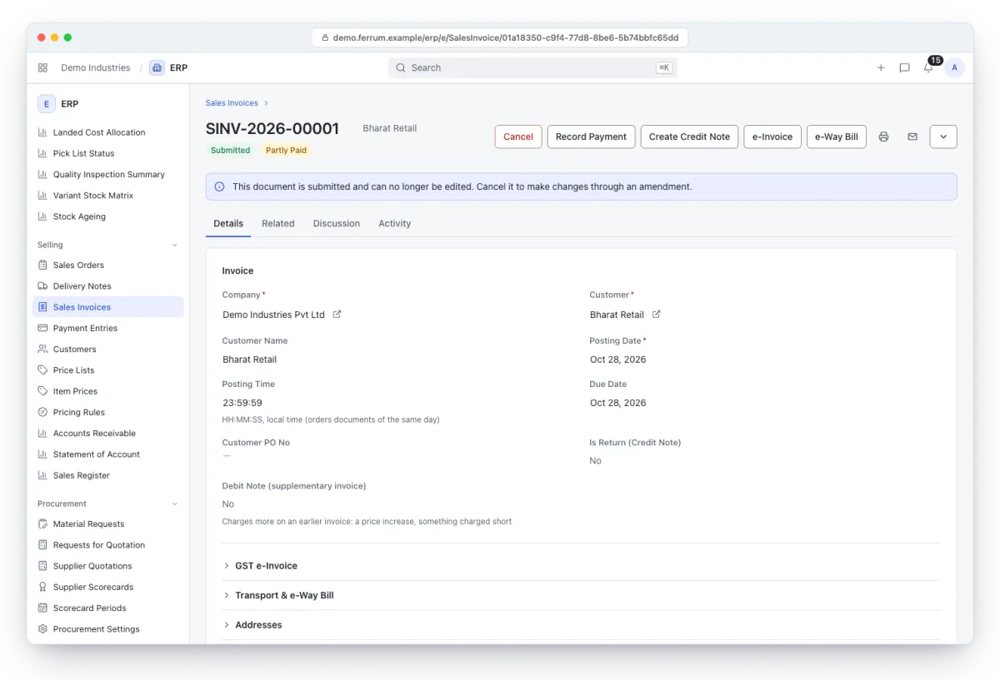</picture>
<p><b>📄 Submitted sales invoice</b><br><sub>Read its taxes and what is still owed; record a payment, a credit note or a refund. It is never edited.</sub></p>
</td>
</tr>
<tr>
<td width="50%" valign="top">
<picture><source media="(prefers-color-scheme: dark)" srcset="docs/assets/screens/erp-sales-invoice-list-dark.webp">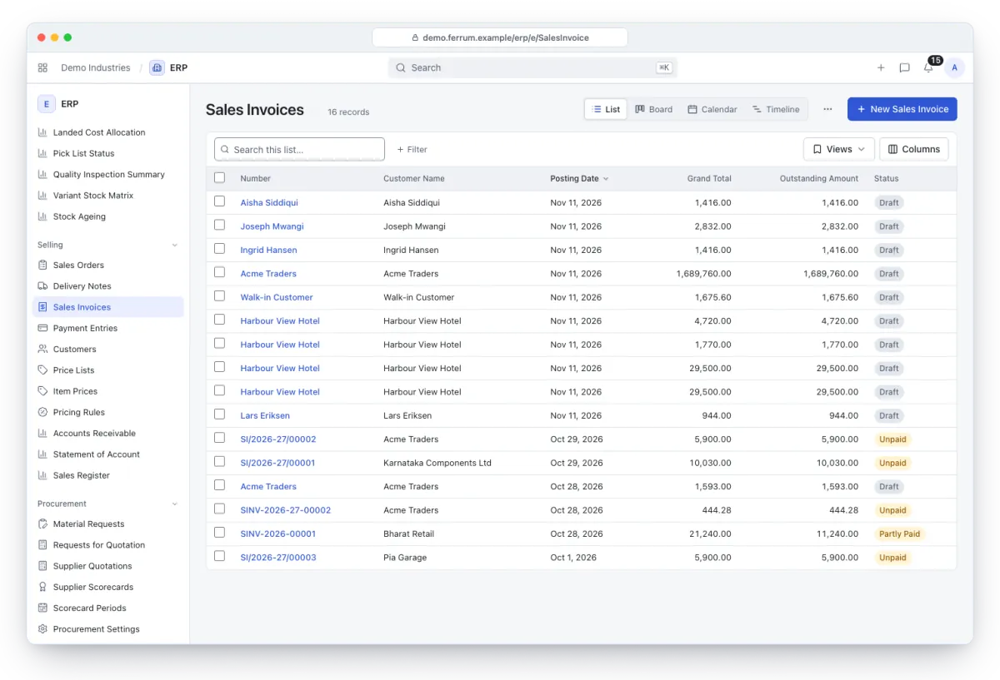</picture>
<p><b>🗂️ Sales invoices</b><br><sub>Browse invoices with their status, customer and amount, and filter them.</sub></p>
</td>
<td width="50%" valign="top">
<picture><source media="(prefers-color-scheme: dark)" srcset="docs/assets/screens/erp-sales-invoice-board-dark.webp">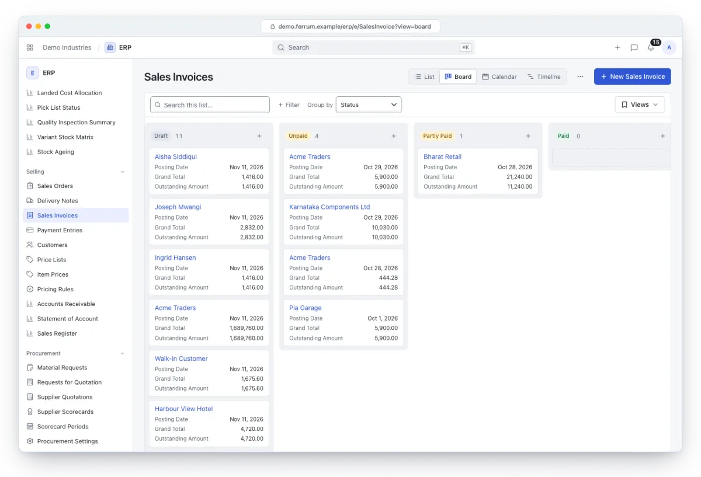</picture>
<p><b>🧱 Invoices as a board</b><br><sub>See invoices as cards in columns by status: unpaid, partly paid, paid.</sub></p>
</td>
</tr>
<tr>
<td width="50%" valign="top">
<picture><source media="(prefers-color-scheme: dark)" srcset="docs/assets/screens/erp-report-profit-and-loss-dark.webp">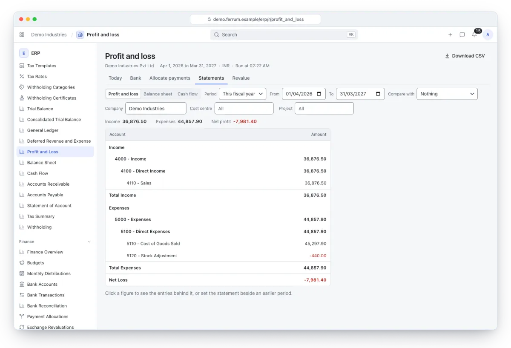</picture>
<p><b>📈 Profit and loss</b><br><sub>Income and expenses for a period beside earlier ones; every figure opens the entries behind it.</sub></p>
</td>
<td width="50%" valign="top">
<picture><source media="(prefers-color-scheme: dark)" srcset="docs/assets/screens/erp-customer-detail-dark.webp">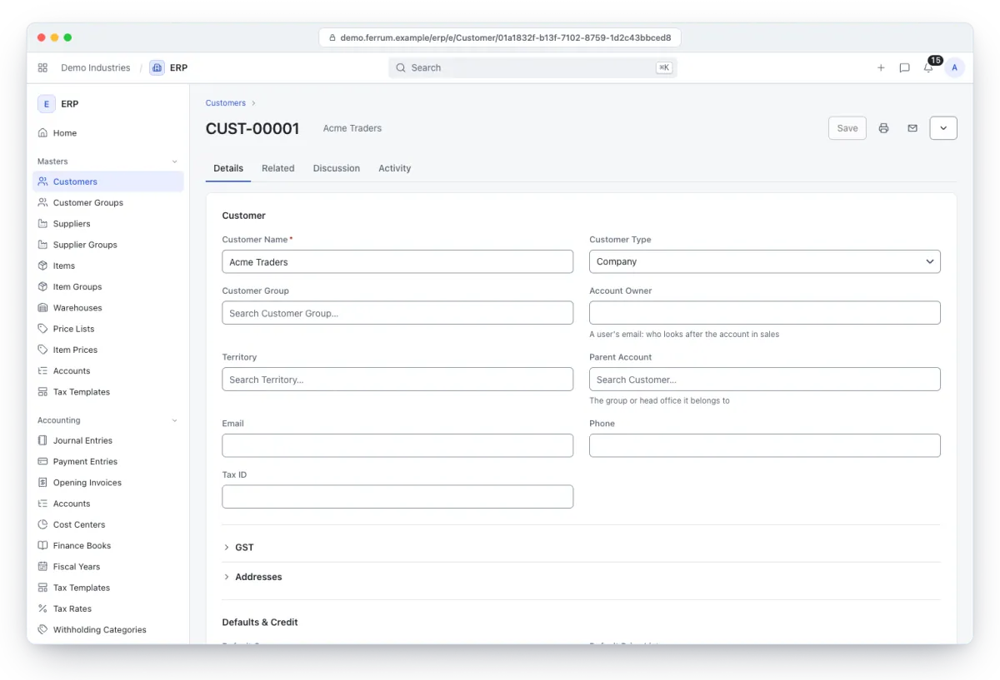</picture>
<p><b>👤 Customer</b><br><sub>A customer's details, addresses, contacts, credit limit and linked documents.</sub></p>
</td>
</tr>
<tr>
<td width="50%" valign="top">
<picture><source media="(prefers-color-scheme: dark)" srcset="docs/assets/screens/wms-home-dark.webp">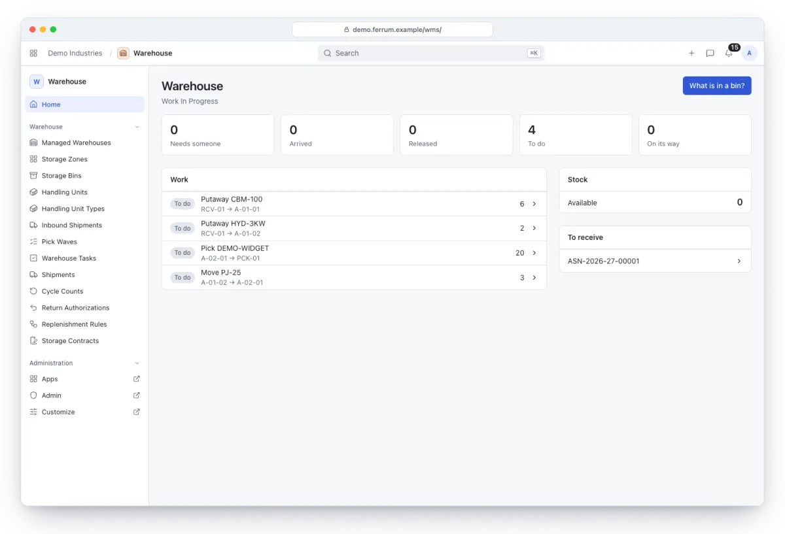</picture>
<p><b>🏬 Warehouse (WMS add-on)</b><br><sub>Putaways, picks and moves to do, what is on its way, and what is expected at the dock.</sub></p>
</td>
<td width="50%" valign="top">
<picture><source media="(prefers-color-scheme: dark)" srcset="docs/assets/screens/erp-items-list-dark.webp">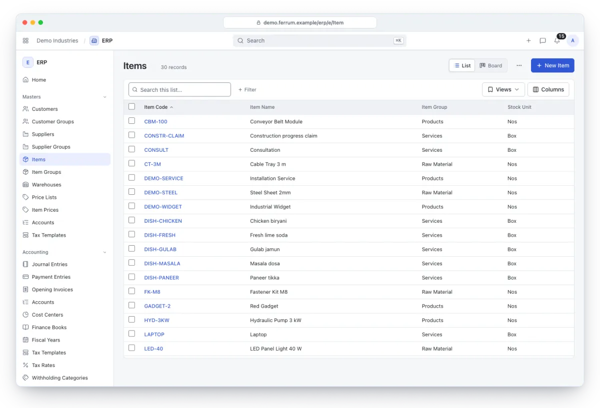</picture>
<p><b>📦 Items</b><br><sub>Browse the products and services you buy, make and sell.</sub></p>
</td>
</tr>
</table>

<details>
<summary>📸 More screens</summary>

<table>
<tr>
<td width="50%" valign="top">
<picture><source media="(prefers-color-scheme: dark)" srcset="docs/assets/screens/erp-sales-order-list-dark.webp">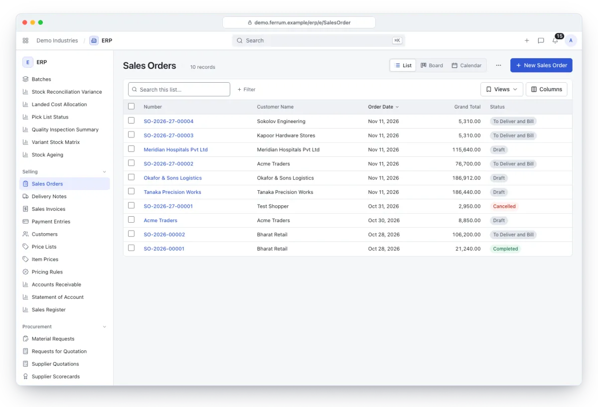</picture>
<p><b>🧾 Sales orders</b><br><sub>See which orders still need delivery or billing.</sub></p>
</td>
<td width="50%" valign="top">
<picture><source media="(prefers-color-scheme: dark)" srcset="docs/assets/screens/erp-sales-order-draft-dark.webp">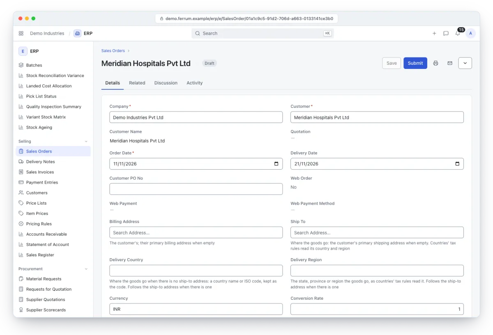</picture>
<p><b>✏️ Draft sales order</b><br><sub>Review the customer, dates and totals of an order before submitting it.</sub></p>
</td>
</tr>
<tr>
<td width="50%" valign="top">
<picture><source media="(prefers-color-scheme: dark)" srcset="docs/assets/screens/erp-sales-invoice-draft-dark.webp">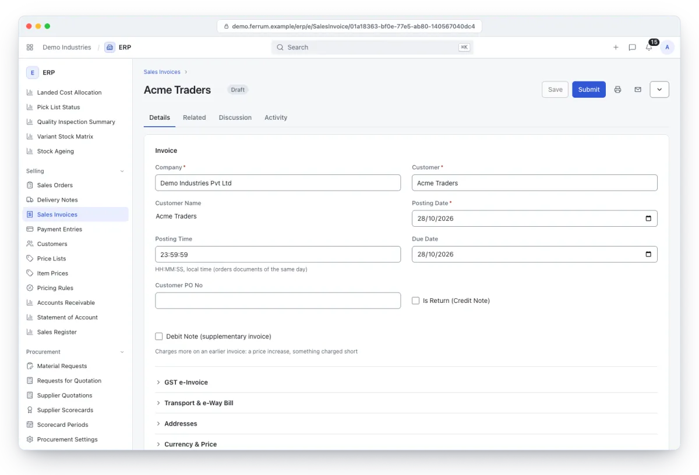</picture>
<p><b>✏️ Draft sales invoice</b><br><sub>Check a draft invoice before submitting it to the books.</sub></p>
</td>
<td width="50%" valign="top">
<picture><source media="(prefers-color-scheme: dark)" srcset="docs/assets/screens/erp-customers-list-dark.webp">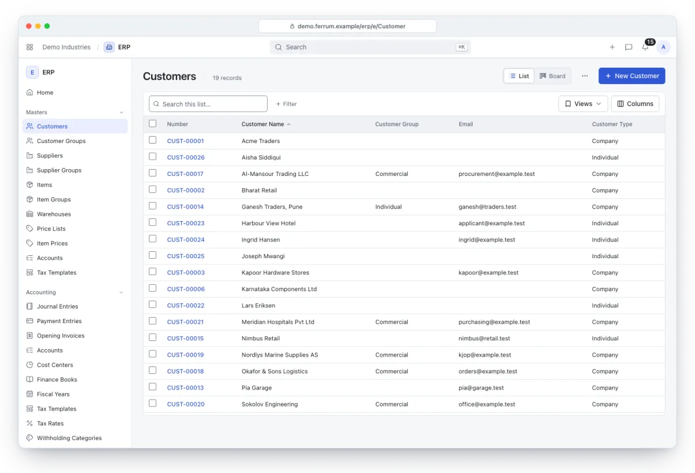</picture>
<p><b>👥 Customers</b><br><sub>Browse, search and filter customers.</sub></p>
</td>
</tr>
<tr>
<td width="50%" valign="top">
<picture><source media="(prefers-color-scheme: dark)" srcset="docs/assets/screens/wms-managed-warehouse-list-dark.webp">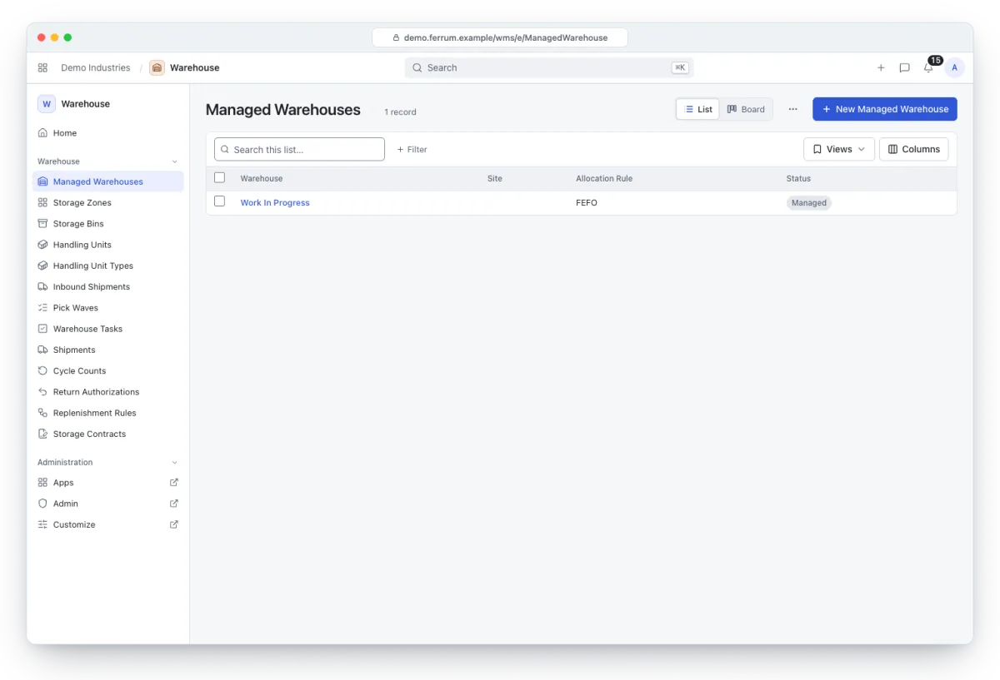</picture>
<p><b>🏬 Managed warehouses</b><br><sub>The warehouses the WMS add-on runs down to the bin.</sub></p>
</td>
<td width="50%" valign="top">
<picture><source media="(prefers-color-scheme: dark)" srcset="docs/assets/screens/wms-storage-zone-list-dark.webp">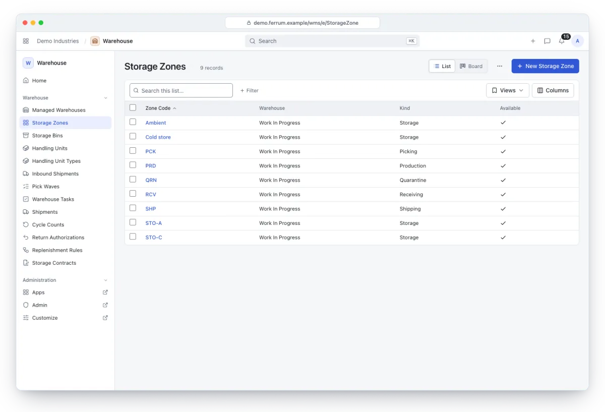</picture>
<p><b>🗺️ Storage zones</b><br><sub>Zones of a managed warehouse and the bins inside them.</sub></p>
</td>
</tr>
<tr>
<td width="50%" valign="top">
<picture><source media="(prefers-color-scheme: dark)" srcset="docs/assets/screens/wms-pick-wave-list-dark.webp">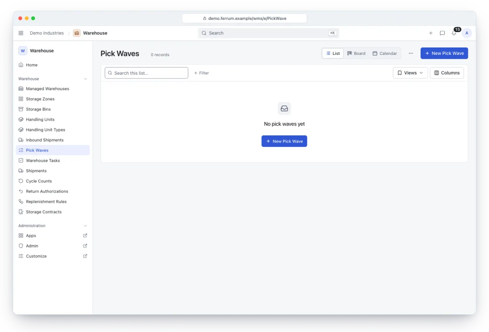</picture>
<p><b>🌊 Pick waves</b><br><sub>Orders released to the floor together, with what could not be allocated.</sub></p>
</td>
<td width="50%" valign="top">
<picture><source media="(prefers-color-scheme: dark)" srcset="docs/assets/screens/mes-home-dark.webp">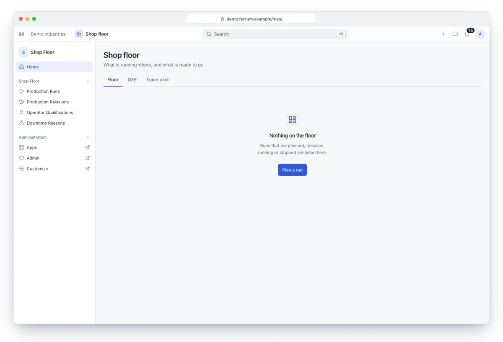</picture>
<p><b>🛠️ Shop floor (MES add-on)</b><br><sub>What runs where, OEE and lot tracing, in three tabs.</sub></p>
</td>
</tr>
<tr>
<td width="50%" valign="top">
<picture><source media="(prefers-color-scheme: dark)" srcset="docs/assets/screens/mes-production-run-list-dark.webp">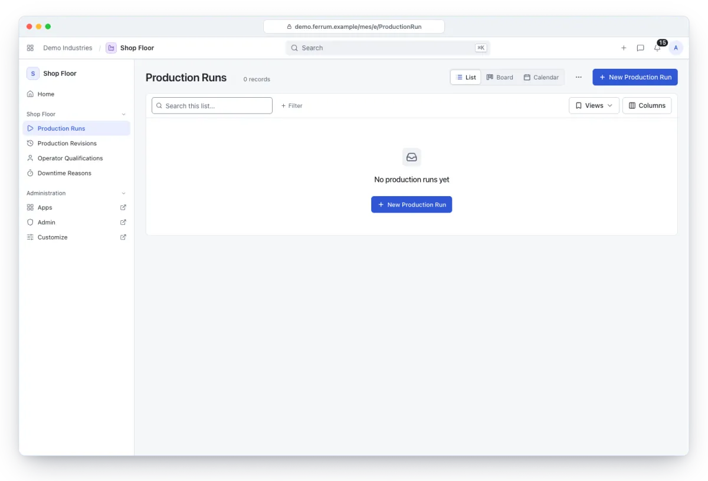</picture>
<p><b>▶️ Production runs</b><br><sub>Every run of a work order on a workstation, from release to its last count.</sub></p>
</td>
<td width="50%" valign="top">
</td>
</tr>
</table>

</details>

<p align="center">
<picture><source media="(prefers-color-scheme: dark)" srcset="docs/assets/screens/erp-home-phone-dark.webp">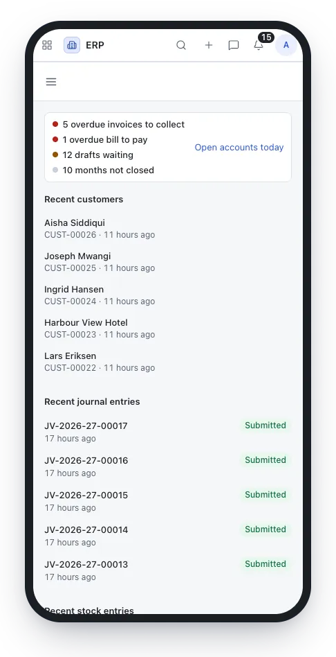</picture>
&nbsp;&nbsp;
<picture><source media="(prefers-color-scheme: dark)" srcset="docs/assets/screens/erp-customers-list-phone-dark.webp">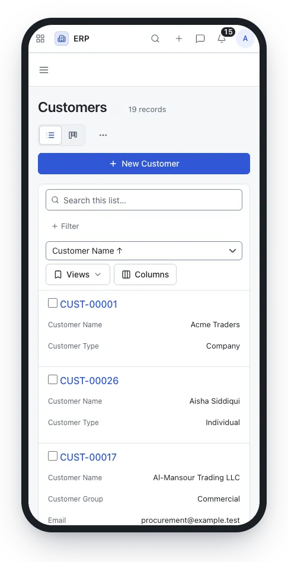</picture>
</p>
<p align="center"><sub>📱 The home and the customer list on a phone.</sub></p>

> [!TIP]
> The screenshots follow your GitHub theme: switch between light and dark to see both.

## ✨ Features

ERP is five packages (accounting, selling, buying, inventory, manufacturing) and the Rust engine behind
them, plus the add-ons in `addons/`. Everything below is in this repository; an add-on's section says which
add-on brings it.

### 📒 Ledger and chart of accounts

- **Universal journal.** One journal for every posting, append-only, balanced at commit, locked by period and
  partitioned by year in the database. Submitting a document posts it; cancelling posts its reversal.
  Receivables and payables are open items with append-only allocations.
- **Companies and groups.** Many companies in one workspace, each with its currency, fiscal year start,
  rounding (half up or half even), cash rounding of totals, tax rounding per document (EN 16931) or per line,
  and its default accounts (receivable, payable, income, expense, cash, bank, inventory, cost of goods sold,
  stock received but not billed, stock adjustment, round-off, exchange gain or loss, retained earnings,
  opening balance, overheads absorbed, deferred revenue and expense).
- **Chart of accounts.** An account tree with groups, account types and a cash flow section; frozen and
  disabled accounts are refused by the database. **Create Standard Chart of Accounts** makes the standard
  chart for a new company, or adds the standard accounts an existing one lacks.
- **Cost centres, projects and accounting dimensions.** A cost centre tree, projects on lines, and dimensions
  of your own (department, branch, product line): their values as a list or another entity's records, the
  accounts or account types that need one, and defaults by company, cost centre, project, party and item.
  Every ledger line carries its dimensions; every statement and budget can filter or group by them.
- **Finance books.** IFRS beside local rules, or a tax book beside both: an entry with no book is in every
  book, an entry with a book adjusts that one alone. Statements, the general ledger and year-end closing take
  a book.
- **Fiscal years and period locks.** Close and reopen an accounting period from the fiscal year; nothing posts
  into a closed month.
- **Journal entries.** Entry types, party lines in the party's own currency with their own due dates,
  reversing entries on a chosen day (accruals that take themselves out the day after, once, by the daily
  upkeep).
- **Recurring journals.** A journal template makes its entry every month, quarter, half-year or year until an
  end date or a count, as a draft or submitted, once per period under a lock.
- **Opening invoices.** A company switching books imports its open invoices in one spreadsheet, each with its
  own number, currency and due date, and posts them all against the opening balance account (all or none),
  so the first ageing report is right.
- **Numbering series.** A series per kind of document (template such as `TINV-{FY}-{seq:5}`, gapless or not,
  a default per company); a person, an app, a rule or a country's add-on picks the series a document takes.
  A gapless series leaves no hole when a submission is refused.

### 🌐 Multi-currency and groups

- **Foreign currency** on invoices, orders, payments and party lines, with realised gains and losses worked
  out on each allocation.
- **Transfers** between the company's own bank and cash accounts, each side in its account's currency.
- **Group consolidation.** A company's parent makes a group: a consolidated trial balance, profit and loss and
  balance sheet in the parent's currency, on the parent's chart. Intercompany business is taken out
  (customers and suppliers that represent a group company, accounts marked Eliminate in Consolidation), and
  what does not cancel shows as an intercompany difference beside each pair's balances.
- **Translation as IAS 21 says.** Assets and liabilities at the closing rate, income, expenses and equity at
  the rate of their day, the rest to the foreign currency translation reserve.
- **Non-controlling interests.** A company says how much of it the parent holds; the consolidated statements
  split equity and profit between the parent's owners and the non-controlling interests. A group's cash flow
  shows the effect of exchange rates on cash.
- **Intercompany invoices.** A sale to a group company makes that company's purchase invoice from the supplier
  that represents the seller, numbered as the sale, once.

### 💳 Payments, cheques and write-offs

- **Payment entries** receive, pay and transfer, with open-item allocation (Get Outstanding Invoices),
  deductions, advances, refunds of a party's credit, and an early-payment discount whose tax is taken back in
  the invoice's proportion.
- **Modes of payment** with an account per company. A mode paid by instrument keeps a **book of numbers**
  (next, last, prefix, digits): a payment out takes the next number on submission, never the same twice.
- **Payment instruments** (cheques, drafts): received or issued, deposited, cleared not before their date,
  bounced (the payment taken back, the invoices owed again, a bounce charge unless left off), cancelled or
  replaced. A message tells the accountant when a post-dated cheque can be deposited; the event
  `instrument_bounced` lets an automation tell the customer.
- **Bad-debt write-off.** One document writes an invoice off to the reason's account, less the tax relief the
  company's country gives through the localization seam; Record Recovery books what comes back.
- **Payment approvals.** Payments to suppliers and refunds to customers can wait for one or two Accounts
  Managers by value band (Payment Approval Settings). Shipped off; the maker never approves their own.

### 🎁 Stored value: gift cards, store credit and packages

- **Kinds** hold money or units (sessions, washes), by a bearer or a named customer, in a liability account;
  each says whether it can be topped up, transferred, cashed out or used in part, whether it needs a PIN, its
  limits, its expiry (from issue or last use, with a warning), what unused value becomes, and whether tax is
  charged when sold or when redeemed.
- **Accounts** keep their balance as the sum of their own append-only ledger, never below zero in the
  database. Codes are kept only as a salted hash and the last four characters; a code and PIN go to a
  single-use proof, never to the audit log or a receipt.
- **Sold** on an invoice line, **redeemed** as a payment, **refunded** onto the card or new store credit,
  **held** for a sales order, **expired** by the upkeep with the event `stored_value_expiring` first. Block,
  unblock, new code, adjust and cash out.
- **Reports:** Stored Value Outstanding, Stored Value Statement, Stored Value Issued and Used.

### 🧮 Taxes, withholding and tax returns

- **Tax templates** chosen by a condition, **tax rates** as dated records (a new rate needs no release),
  inclusive, compound, per-unit and deducted taxes, tax categories and exemption reasons, reverse charge, and
  a tax breakdown per category and rate on every document (EN 16931).
- **Delivery country and region** on sales and purchase documents, which every country's rules read
  (ship-to address first, then these fields, then the party's address).
- **Tax registrations** of seller and buyer, answered by the country's add-on and kept on the document for
  its print.
- **Withholding by category.** Deducted on the bill, on payment or collected on a sale; on the net or the
  grand total; dated rates with per-document and yearly thresholds; certificates for a lower rate or none, up
  to a limit. Parties and items name a category; returns take back their share. Withholding desk and report.
- **Tax returns as definitions.** A return's boxes are sums of the tax ledger filtered by tax, rate, category,
  direction, place and document kind, or formulas, or typed by hand. A return for a period is worked out
  while it is a draft, adjusted with reasons, and filing keeps the values and closes the period to invoices.
  Each box drills down to its documents; a CSV export comes with it.
- **Tax summary report** by tax account, category, rate and reverse charge, output and input, for any period.

### 🧾 Selling

- **Sales orders** with delivery dates and warehouses per line, statuses To Deliver and Bill, To Deliver, To
  Bill, Completed, Closed. **Update Items** changes a submitted order (quantities never below what was
  delivered or billed, lines added and removed, dates, prices of what is not yet billed); closing shows what
  was closed short.
- **Availability and promised dates.** A draft line shows what is available at its warehouse and gets a
  promised date: today, the day a purchase or work order brings enough, or the item's lead time.
- **Stock reservation.** Per company (or item group): Count Only, or Hold, where an order's lines hold free
  stock (the rest back-ordered) when submitted or on demand, for a set number of days; no other delivery may
  take it.
- **Delivery notes** in parts, with progress per line, returns limited to what is left, and Ship by Carrier.
- **Sales invoices** that may update stock themselves, with Record Payment, credit notes (of goods or of price
  alone, with or without an original), debit notes and refunds. Statuses Unpaid, Partly Paid, Paid, Return,
  Credit Note Issued.
- **Lines without an item** booked straight to an income account (a fee, a one-off charge).
- **Allowances** for over-delivery and over-billing, per company or item.
- **Credit limits** on orders, deliveries and invoices without counting twice, a credit hold on the customer
  (payments and credit notes still taken), and a release with a reason by an Accounts Manager.
- **Deferred revenue** for a line over a service period, recognised by the day.
- **Reports:** Accounts Receivable with ageing, Statement of Account, Sales Register, Promotions Given.

### 🏷️ Pricing and promotions

- **Price lists** by currency, unit and validity, for selling or buying; **pricing rules** by item, item group,
  customer, customer group, quantity, dates and a condition, as a discount or a fixed rate.
- **Promotions** over a whole sale: when (dates, weekdays, hours in the company's time zone, customers,
  channels, places, a code, a first order, a minimum spend or quantity), what (percent or amount off the
  document or lines, buy some get some, cheapest or dearest first, a bundle price, free delivery, a free item)
  and how they combine (priority, alone or with others, a cap). A discount spread over lines keeps each line's
  exact share, so a return gives back the same share.
- **Promotion codes**, one shared or many unique, each with its limit; counted once on submit, given back on
  cancel; of two documents racing for the last use, one gets it.
- **One pricing engine.** `ferrum-erp-pricing` prices a whole basket from a versioned snapshot (prices, units,
  rules, promotions, taxes, rounding, tax summary) with no database, no clock and no floats; the server uses
  its pieces, and `scripts/pricing-wasm.sh` builds it for a till's browser ([docs/pricing.md](docs/pricing.md)).
  A sale an app priced itself is checked against the promotion records before it is accepted.

### 🛒 Buying

- **Purchase orders**, **purchase receipts** and **purchase invoices** with three-way matching against orders
  and receipts, Update Items on a submitted order, Close and Re-open, and allowances for over-receipt.
- **Bills straight to an account** (rent, electricity, a consultant's fee), deferred expense over a service
  period, returns, debit notes and refunds.
- **Rejected goods.** A receipt's rejected quantity goes to a rejected-goods warehouse at no value and is
  never billed; Return Rejected Goods makes the return or a debit note.
- **Approved manufacturers and suppliers** per item, with their part numbers and priority.
- **Purchase approvals** by value band: a Purchase Manager, then an Accounts Manager, then two more. Shipped off
  (Purchase Approval Settings); stand-ins and escalation are the platform's.
- **Serial number labels** printed from a receipt.
- **Reports:** Accounts Payable with ageing, Purchase Register, Statement of Account.

### 📦 Stock and warehouses

- **Stock ledger.** Append-only, with moving-average and FIFO cost layers, valued once at posting.
- **Warehouses** in a tree per company, each holding Stock, Transit or Rejected goods; only Stock is offered to
  orders and promising.
- **Stock entries** for opening stock, receipts, issues, transfers and manufacture. **Ship now, receive later:** a transfer
  goes through a transit warehouse and is received in parts, with what is short or damaged written off or
  claimed with a reason.
- **Serial numbers** held exactly (one place per serial); **batches** with expiry; an expired or disabled
  batch never leaves for use.
- **Scanning.** A company capability says what a scanned text is: an item by barcode or code, a batch, a
  serial, a bin, a document by number, a shipment by tracking number, or a GS1 string's GTIN, batch, expiry,
  serial and quantity.
- **Labels** for items (a page or label-printer ZPL text), parcels, serials, batches and bins, printed for many
  records at once.
- **Reports:** Stock Balance, Stock Ledger, Goods in Transit.

### 🚚 Carriers and shipments

- **Carrier connections** described as four HTTP calls (rates, label, tracking, cancel) over the platform's
  connections, with secrets kept in the connection. No carrier is built in; [docs/carriers.md](docs/carriers.md)
  shows how to describe one, with two worked examples, and a test carrier answers from fixtures.
- **Carrier shipments** from a delivery note or a purchase return: parcels, Get Rates, Choose Rate, Buy Label
  (bought once however often it is pressed), Track (by the upkeep or by the carrier's own calls), Cancel Label.
  Label cost is not booked, absorbed as freight, or charged to the customer on the invoice.
- **Shipping desk** for parcels, rates, labels and tracking.

### 🏭 Manufacturing and planning

- **Bills of materials**, multi-level with revisions, scrap, reference designators and Update Cost; **by-products
  and co-products** valued by a value per unit or a share of cost, with the rest shared by quantity, ratio or
  standard value, summing to the cent.
- **Work orders** with Produce (materials backflushed, finished goods and other outputs received), Stop and
  Resume, and actual costing.
- **MRP runs** by day, week or month over a horizon, across several warehouses: demand from sales orders,
  work orders and planned parents; a short warehouse takes another's spare stock by a proposed transfer
  before anything is bought; orders lot-sized by each item's planning rows (safety stock, minimum, multiple,
  maximum, lead time); **action messages** to bring forward, push out, cancel, increase or decrease existing
  orders. Create Orders makes the purchase orders, work orders and transfers.
- **Planning desk** to take planned orders in bulk, see action messages and check promise dates.

### 💼 Finance add-on (0.6.2)

- **Bank accounts** tied to their ledger accounts (IBAN checked), statements imported from CSV (columns guessed,
  a trial run first, lines already there skipped), and a **reconciliation workbench**: statement lines beside
  the books with the running bank balance, exact matches paired so none is used twice, keyboard shortcuts,
  many-to-one matches, a payment or journal entry made from a line, the difference always in view.
- **Payment allocation**: a party's payments, credit notes and journal credits applied to open invoices in one
  document, oldest first, with each pairing's exchange gain or loss.
- **Payment runs**: bills due by a day and those whose early-payment discount is open, leaving out bills on hold;
  reviewed, approved, then paid one payment per supplier, with a bank file from a template (ISO 20022
  pain.001.001.03 or CSV; a bank's own format is another template) and remittance advice. Pressed twice it
  pays nothing twice. Hold Payment and Release Payment on a bill.
- **Payment terms** that split an invoice into installments with their own due dates and early-payment
  discounts, and **dunning** by level with fees, yearly interest and a letter.
- **Budgets** per account for a cost centre, project or dimension value, phased by month (monthly
  distributions), with Stop, Warn or Ignore on actuals, orders and requests.
- **Exchange revaluation** of bank, receivable and payable balances at a period's end, reversed the day after.
- **Period closing voucher** that moves the year's income and expenses to the closing account and locks the
  year.
- **Subscriptions** with plans, trials, billing anchors, proration on plan changes and cancellation; revenue
  earned over the days it pays for; MRR, ARR, churn and net revenue retention.
- **Reports:** Finance Overview (Accounts today), Budget Variance, Bank Reconciliation Statement, Cash Flow
  Forecast, Receivables by Due Date, Dunning Summary, Subscription MRR, ARR and Churn.

### 📋 Procurement add-on (0.1.5)

- **Material requests** to buy, transfer, issue, manufacture or receive from a customer, each line tracking
  what was ordered and received; purchase requests become purchase orders grouped by preferred supplier.
- **Re-order levels** per item and warehouse raise requests when projected stock falls below them.
- **Requests for quotation** reach each supplier with a signed link to a page where they answer; **supplier
  quotations** are valid until a day and never ordered twice.
- **Supplier scorecards** per month or quarter from delivery, quality, price and responsiveness, whose standing
  warns about or blocks new requests and orders.
- **Reports:** Material Request Status, Procurement Tracker, Supplier Quotation Comparison, Supplier Scorecard
  Ranking, Purchase Analytics.

### 🗃️ Stock Operations add-on (0.2.1)

- **Stock reconciliation** of counted quantities (and rates), cancelled exactly.
- **Landed cost vouchers** that add freight, duty and other charges to received stock still on hand.
- **Pick lists** by warehouse, batch (earliest expiry first) and serial, holding what they pick; **packing
  slips** for a delivery note, which then leaves only fully packed.
- **Quality inspection** templates with acceptance criteria; receipts and deliveries wait for an accepted
  inspection where an item needs one, and an inspection can accept part and reject the rest.
- **Item variants** from a template's attributes, and **product bundles** sold as kits.
- **Batch labels** and a packing slip print layout.
- **Reports:** Stock Reconciliation Variance, Landed Cost Allocation, Pick List Status, Quality Inspection
  Summary, Variant Stock Matrix, Stock Ageing.

### ⚙️ Manufacturing Operations add-on (0.2.1)

- **Workstations** with an hour rate, working hours, holidays and parallel capacity; **operations** and
  **routings** that cost a BOM's operating time into finished goods.
- **Work orders** copy their operations and are scheduled forward over working hours when submitted; **job
  cards** log time and quantity, never more jobs at a workstation than it holds.
- **Production plans** from sales orders, material requests or typed in, exploded over every level and netted
  against projected stock, then made into work orders and material requests.
- **Subcontracting**: materials sent to a supplier's warehouse, goods received at the materials' value plus
  the service and other costs.
- **Reports:** Job Card Summary, Capacity Planning, Work Order Operations, Production Plan Status,
  Subcontracting Status.

### 🏬 Warehouse Management add-on (WMS, 0.3.1)

Its own app, **Warehouse**, at `/wms/`, with screens to receive, scan, ship, count, see a bin and work a task.

- **One balance.** Positions by bin, lot, owner and status are a subledger of ERP's stock; the database refuses
  any commit where the two differ, and every change has its ledger row.
- **Managed warehouses, zones and bins** with weight, volume, hazard and temperature rules; **handling units**
  (pallets, totes, cartons) with SSCC and custody.
- **Receiving** by scan against an inbound shipment: damaged goods to quarantine, over-receipt needs a manager,
  unknown goods stay off the books until someone says what they are.
- **Putaway, pick waves and replenishment** with FEFO or FIFO allocation; a move finishes only on a scan of the
  place and of the load; a refused scan stays on record.
- **Packing and shipping** with each unit verified; **line supply** to production; **cycle counts**, blind if
  wanted, with a second counter and an approver; **returns**, **holds** and **storage billing** for customers'
  stock.
- **People and robots on one task list**, robots through the platform's Operations app; a robot arriving moves
  nothing until the destination is scanned. Tried on a simulated fleet only.

### 🛠️ Manufacturing Execution add-on (Shop Floor, 0.2.4)

Its own app, **Shop Floor**, at `/mes/`, with the floor, OEE and lot tracing.

- **Production runs** of a work order on a workstation, released only through gates: an approved revision, a
  qualified operator, equipment that can run, and material there and not claimed by another run.
- **A second gate at the machine**: material at the station, every prerequisite asked again, a hold stops the
  start.
- **An operator's terminal** with big buttons; every press has its own id, so a shaky connection counts once.
- **Lot genealogy** forward for a recall and back for an investigation, scrap included.
- **OEE** by a written definition per workstation and period; a figure with nothing to divide by is unknown,
  not zero.
- **Approved production revisions** that never change once used; whoever wrote one does not approve it.
- Discrete manufacturing only, and tried on a simulated press only. It sends machines an approved job number,
  never controller logic.

### ✅ Quality add-on (0.1.0)

- **Quality holds** by item and lot that stop ERP from shipping or consuming that stock, the warehouse from
  allocating it and the floor from using it; receipts still pass. Whoever placed a hold does not release it.
- **Nonconformances** with a disposition, and **corrective actions** (CAPA) closed only when someone other than
  the owner has seen them work.
- **Inspection plans** per item and revision; an approved plan does not change.

### 🖨️ Print layouts and documents

| What | Layouts |
|---|---|
| 🧾 Selling | Sales order and pro forma, delivery note, sales invoice (credit and debit notes among them) |
| 🛒 Buying | Purchase order, purchase receipt, purchase invoice |
| 💳 Accounting | Payment entry (receipts, payments, refunds, transfers), journal voucher |
| 📦 Stock | Stock entry; packing slip (Stock Operations) |
| 🇮🇳 India | India's tax invoice |
| 🏷️ Labels | Item (page or ZPL), parcel, serial, batch, bin |
| 📤 Files | Tax return CSV, India's GSTR-3B JSON and GSTR-1 CSV, ISO 20022 pain.001 and CSV bank files, remittance advice |

Every printed document carries the company's **letterhead** (address, contact, logo), its bank details, default
terms and a footer, filled in once on the company.

### 🖥️ ERP's own screens

| Screen | What you do there |
|---|---|
| 🏠 Home | What needs the books today, recent records, every module |
| ☀️ Accounts today (Finance) | Overdue and soon-due receivables and payables, bank lines to reconcile, drafts waiting, months to close, cash |
| 🏦 Bank reconciliation (Finance) | Import a statement, pair lines with the books, accept matches with one key |
| 🔁 Payment allocation (Finance) | Apply payments and credits to open invoices |
| 📊 Statements | Profit and loss, balance sheet and cash flow beside up to three earlier periods, by cost centre or project, every figure opening its entries |
| 💱 Exchange revaluation (Finance) | Revalue foreign balances at a day's rate |
| 💸 Payment run desk (Finance) | Propose, review, approve, pay, and download the bank file |
| 🧾 Tax return workbench | Boxes, drill-down, adjustments, files, filing |
| ✂️ Withholding desk | Categories with the rate in force, statements per party |
| 🎁 Stored value desk | Find a card, issue, top up, hold, release |
| 🏷️ Promotions desk | A promotion's settings and a test basket priced by the server |
| 🚚 Shipping desk | Parcels, rates, labels, tracking |
| 🗓️ Planning desk | Planned orders by period, action messages, promise dates, reservations |
| 🔢 Numbering desk | Series per document kind and which one is the default |

Every other record opens in Ferrum's records frame with lists, boards, forms, search, filters, exports and
history. Desks show only where their package is installed and only to people who may read what they work on.

### 🌐 Portal

- **Customers** see their own invoices at `/portal/invoices/`: what is still due, the lines, and the invoice as
  printed.
- **Suppliers** see at `/portal/orders/` the requests for quotation waiting for them (with Procurement), their
  purchase orders with what was received and billed, and their bills with what is still owed.

### 🔐 Roles, permissions and personal data

- **Ten roles**: Accounts Manager and User, Sales Manager and User, Purchase Manager and User, Stock Manager and
  User, Manufacturing Manager and User. Add-ons add Quality, Warehouse and Production roles.
- **Company scoping.** A link on a company's record offers only that company's warehouses, accounts, cost
  centres and other masters, and lists show the company.
- **Erasure.** A person's request reaches suppliers' bank details and run lines; payments, instruments,
  certificates, write-offs and stored value are kept as the books and named in the answer.
- **Row-level security and audit** come from the platform, for people, apps and AI agents alike.

### 🔌 For other apps

- **Engine modules** in this crate: `ledger`, `stock`, `pricing`, `promotion`, `stored_value`, `flow` and
  `localization`; [docs/contracts.md](docs/contracts.md) says how each operation behaves (in the caller's
  transaction, appending, what it refuses, whether calling twice does it twice).
- **Contracted capabilities**: `core.company.availability`, `core.company.price_lines`, `core.company.scan`, and
  stored value's `prove`, `balance`, `issue`, `redeem`, `refund`, `transfer`, `hold`, `release` and `reverse`.
- **Events** `accounting.instrument_bounced` and `accounting.stored_value_expiring`, for automations.

### 🌍 Countries

Each country is its own app in the store, active only for companies of that country. Its fields carry its code
as a prefix (`in_gstin`), and its rules plug into the seam described in [How it works](#-how-it-works).

| | Country | Add-on | Taxes and rules | Returns | E-invoices and filing |
|---|---|---|---|---|---|
| 🇮🇳 | India | `ferrum-india` 0.6.0 | GSTIN, place of supply, CGST and SGST or IGST, HSN/SAC, reverse charge on purchases, TDS categories with dated rates | GSTR-3B and GSTR-1 as return definitions, with JSON and CSV exports | E-invoices (IRN, signed QR) and e-way bills through the IRP or a GSP |
| 🇪🇺 | European Union | `ferrum-eu` 0.3.0 | Rates from TEDB, intra-Community supplies with VIES checks, One-Stop Shop, exports, acquisitions | EC sales list, OSS return, Ireland's VAT3 | EN 16931 (Peppol BIS 3.0) to the company's Peppol access point |
| 🇩🇪 | Germany | `ferrum-de` 0.1.0 | Small businesses (§ 19 UStG), domestic reverse charge (§ 13b) | — | XRechnung 3.0 checked against KoSIT's rules |
| 🇧🇪 | Belgium | `ferrum-eu-members` 0.1.0 | Small business franchise, contractors' reverse charge, KBO/BCE numbers | — | Peppol between Belgian businesses |
| 🇫🇷 | France | `ferrum-eu-members` 0.1.0 | Franchise en base, construction reverse charge, mandatory mentions, SIREN and SIRET | E-reporting of other sales | EN 16931 to the company's plateforme agréée |
| 🇮🇹 | Italy | `ferrum-eu-members` 0.1.0 | Regime forfettario, domestic reverse charge, Natura codes, virtual stamp duty | — | FatturaPA through the company's SDI channel |
| 🇵🇱 | Poland | `ferrum-eu-members` 0.1.0 | Small business exemption, domestic reverse charge, NIP | — | FA(3) for KSeF |
| 🇵🇹 | Portugal | `ferrum-eu-members` 0.1.0 | Article 53 exemption, construction reverse charge, NIF | — | Certified invoices: ATCUD, signed hash chain, QR code |
| 🇷🇴 | Romania | `ferrum-eu-members` 0.1.1 | Small business exemption, domestic reverse charge, CIF | — | CIUS-RO through ANAF's e-Factura |
| 🇪🇸 | Spain | `ferrum-eu-members` 0.1.0 | Recargo de equivalencia; Canary Islands, Ceuta and Melilla | — | VERI\*FACTU chained records and QR code, sent to AEAT |
| 🇬🇧 | United Kingdom | `ferrum-gb` 0.2.0 | VAT 20%, 5%, zero, exempt; CIS reverse charge; VAT number check | VAT return, nine boxes | Filed through HMRC's Making Tax Digital |
| 🇺🇸 | United States | `ferrum-us` 0.1.0 | Sales tax by destination at ZIP rates where registered, marketplace facilitators, exemption certificates, taxability, use tax | Sales tax by jurisdiction, economic nexus, Forms 1099 | Sales reported to Avalara AvaTax |
| 🇨🇦 | Canada | `ferrum-ca` 0.1.1 | GST/HST, PST/RST and QST by province of supply, input tax credits | GST/HST (GST34) and QST | — |
| 🇸🇬 | Singapore | `ferrum-countries` 0.2.0 | GST 9%, reverse charge | GST F5 | PINT SG through InvoiceNow |
| 🇲🇾 | Malaysia | `ferrum-countries` 0.2.0 | Sales tax and service tax | SST-02 | MyInvois through LHDN |
| 🇮🇩 | Indonesia | `ferrum-countries` 0.2.0 | PPN on 11/12 of the price, luxury goods at 12% | SPT Masa PPN | — |
| 🇹🇭 | Thailand | `ferrum-countries` 0.2.0 | VAT 7%, exports at 0% | PP.30 | — |
| 🇵🇭 | Philippines | `ferrum-countries` 0.2.0 | VAT 12% | 2550Q | — |
| 🇻🇳 | Vietnam | `ferrum-countries` 0.2.0 | VAT 10%, 8% and 5% | 01/GTGT | — |
| 🇸🇦 | Saudi Arabia | `ferrum-countries` 0.2.0 | VAT 15%, reverse charge | ZATCA's VAT return | — |
| 🇦🇪 | United Arab Emirates | `ferrum-countries` 0.2.0 | VAT 5%, reverse charge | VAT 201 by emirate | PINT AE |
| 🇦🇺 | Australia | `ferrum-countries` 0.2.0 | GST 10%, GST-free and input-taxed supplies, ABN check | BAS GST labels | PINT A-NZ |
| 🇳🇿 | New Zealand | `ferrum-countries` 0.2.0 | GST 15%, IRD number check | GST101A | PINT A-NZ |
| 🇯🇵 | Japan | `ferrum-countries` 0.2.0 | Consumption tax 10% and 8%, qualified invoices, T-number | Consumption tax return | JP PINT |
| 🇲🇽 | Mexico | `ferrum-countries` 0.2.0 | IVA 16%, 8% in the border regions, 0%, exempt; RFC | Cash-basis IVA return | — |
| 🇨🇳 | China | `ferrum-countries` 0.2.0 | VAT 13%, 9% and 6%, small-scale taxpayers | VAT return figures | — |

### 🗣️ Languages and accessibility

- ERP's own words, its reports' names and the records pages in English, Arabic and Hindi; a workspace can
  translate its own words. Pages mirror right to left, and a negative figure keeps its sign.
- Built on Ferrum's interface kit: no text under 12px, loading states shaped like what is coming, empty, denied,
  offline and failed told apart, menus inside the page's landmarks, 44px buttons on touch in the warehouse
  and shop floor screens.

## 🧭 How it works

### 🔁 Documents and the two ledgers

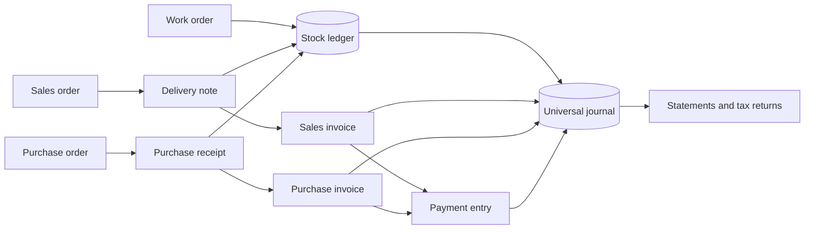

A document is a draft until it is submitted. Submitting posts it: stock moves to the stock ledger at the cost
it has at that moment, money to the universal journal, both append-only. Cancelling posts the reverse, so
every report, from the trial balance to a tax return, reads the same two ledgers.

### 🧩 ERP inside Ferrum

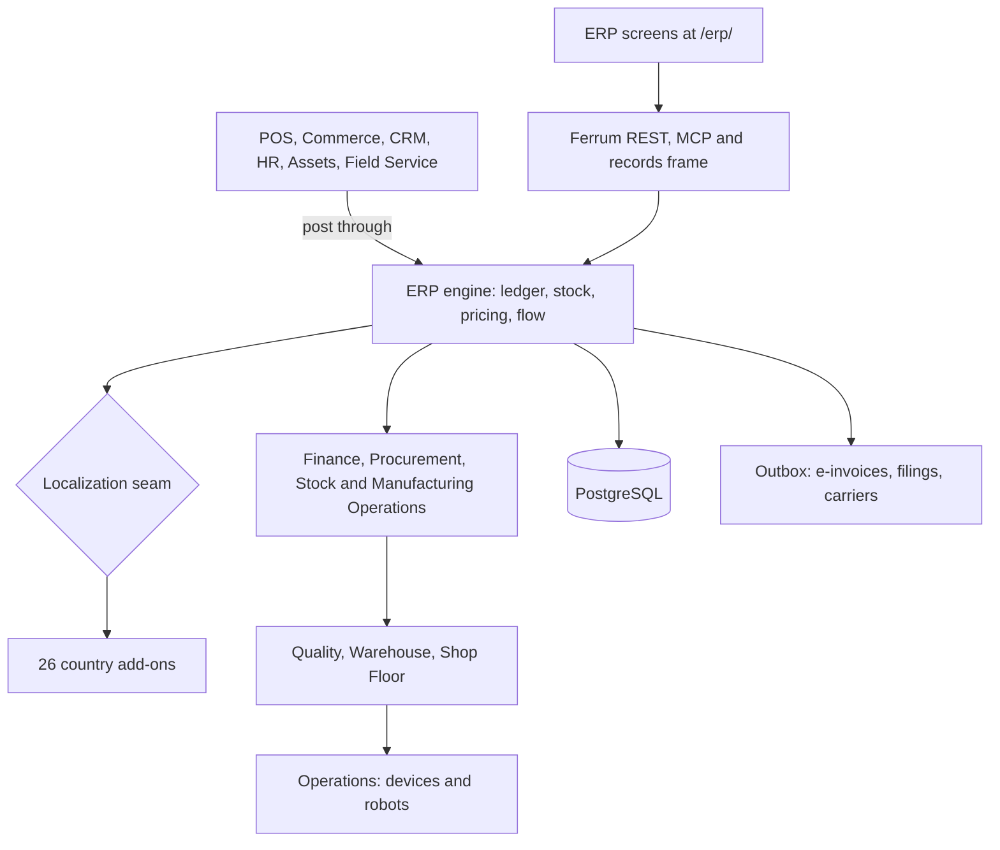

Other apps call the engine in their own transaction rather than copying its rules. Calls to tax portals,
e-invoicing networks and carriers go through the platform's outbox and connections, so no save waits on an
outside service and a retry never sends twice.

### 🌍 The localization seam

| The seam | When it runs | What a country answers |
|---|---|---|
| `determine` | Inside pricing, before prices and taxes, for ERP's documents, CRM's quotations, POS's sales and Commerce's carts | Which taxes apply (India: the GST template for the place of supply; the EU: home, intra-EU, OSS, export or reverse charge) |
| `line_rates` | After an item's own rates, line by line | The rate of the country whose VAT applies |
| `check` | Before a priced document is submitted | What must be on it (India: HSN/SAC; the EU: a VAT number confirmed in VIES) |
| `number_series` | When a document names no series | A country's own series (a simplified invoice) |
| `setup_company` | After a new company's chart of accounts | The country's tax accounts and templates |
| `tax_ids`, `registered` | On documents and prints | The company's and the party's tax registrations |
| `bad_debt_relief` | On a bad-debt write-off | The tax relief the country gives |

## 🧱 Data model

### 📒 Accounting

| Entity | What it is | Key fields or states |
|---|---|---|
| Company (extended) | A legal entity and its defaults | currency, default accounts, rounding, parent company, share held, letterhead, reservation policy |
| Account | A ledger account in the tree | type, root type, cash flow section, frozen, disabled |
| Cost Center | A node of the cost centre tree | parent, company |
| Accounting Dimension | An analysis axis of your own | values, required for, defaults |
| Finance Book | A parallel set of books | name |
| Fiscal Year | A year and its periods | Close / Reopen Accounting Period |
| Journal Entry | A manual or recurring posting | entry type, lines with party and dimensions, reverse it on |
| Journal Template | A recurring journal | frequency, end date or count, draft or submitted |
| Payment Entry | Money received, paid or transferred | Receive, Pay, Internal Transfer; allocations, deductions, approval |
| Payment Instrument | A cheque or draft | Received, Issued, Deposited, Cleared, Bounced, Cancelled, Replaced |
| Mode of Payment | How money moves | accounts per company, book of numbers |
| Opening Invoice | An invoice from the old books | Unpaid, Partly Paid, Paid, Credit |
| Bad Debt Write-off | An invoice written off | reason, relief, Record Recovery |
| Write-off Reason | Where a write-off goes | account per company |
| Tax Template | Taxes applied together | condition, tax rows |
| Tax Rate | A country's dated rate | country, region, category, from, to |
| Withholding Category | Tax withheld or collected | dated rates, thresholds, accounts |
| Withholding Certificate | A party's lower rate or exemption | period, limit |
| Tax Return Definition | A return's boxes | sums, formulas, by-hand boxes |
| Tax Return | A return for a period | Draft, filed (submitted), cancelled |
| Numbering Series | How a document kind is numbered | template, gapless, default |
| Payment Approval Settings | Value bands for payments | Ask for Approval, bands |
| Stored Value Kind | A kind of gift card, credit or package | money or units, expiry, PIN, tax timing |
| Stored Value Account | One card, credit or package | balance, held, state, expiry |

### 🧾 Selling, buying, stock and manufacturing

| Entity | What it is | Key fields or states |
|---|---|---|
| Pricing Rule | A discount or rate by condition | apply on, party, quantity, dates, priority |
| Promotion | A discount over a whole sale | conditions, what it gives, stacking, limits |
| Promotion Code | A code that opens a promotion | shared or unique, limit |
| Sales Order | An order from a customer | To Deliver and Bill, To Deliver, To Bill, Completed, Closed |
| Delivery Note | Goods sent | To Bill, Completed, Return |
| Sales Invoice | A bill to a customer | Unpaid, Partly Paid, Paid, Return, Credit Note Issued |
| Purchase Approval Settings | Value bands for purchase orders | Ask for Approval, three bands |
| Purchase Order | An order to a supplier | To Receive and Bill, To Receive, To Bill, Completed, Closed |
| Purchase Receipt | Goods received | To Bill, Completed, Return; rejected quantity |
| Purchase Invoice | A supplier's bill | Unpaid, Partly Paid, Paid, Return, Debit Note Issued |
| Warehouse | A place stock is kept | holds Stock, Transit or Rejected; parent |
| Stock Entry | A stock movement | purpose; In Transit, Partly Received, Received |
| Carrier Connection | A carrier described as calls | rates, label, track, cancel; connection |
| Carrier Shipment | Parcels going by a carrier | Draft, Rated, Label Bought, In Transit, Delivered, Exception, Cancelled |
| Bill of Materials | How an item is made | revision, items, by- and co-products, cost |
| Work Order | Making an item | Not Started, In Process, Completed, Stopped |
| MRP Run | A planning run | Draft, Planned, Orders Created; lines, action messages |

### ➕ Add-on entities

| Add-on | Entities |
|---|---|
| 💼 Finance | Bank Account, Bank Transaction, Payment Allocation, Payment Run, Payment Terms Template, Dunning Type, Dunning, Budget, Monthly Distribution, Exchange Revaluation, Period Closing Voucher, Subscription Plan, Subscription |
| 📋 Procurement | Material Request, Request for Quotation, Supplier Quotation, Supplier Scorecard, Scorecard Period, Procurement Settings |
| 🗃️ Stock Operations | Stock Reconciliation, Landed Cost Voucher, Pick List, Packing Slip, Batch, Quality Inspection, Quality Inspection Template, Item Attribute, Product Bundle |
| ⚙️ Manufacturing Operations | Workstation, Workstation Type, Operation, Routing, Job Card, Production Plan, Subcontracting BOM, Subcontracting Order, Subcontracting Receipt |
| 🏬 Warehouse | Managed Warehouse, Storage Zone, Storage Bin, Replenishment Rule, Handling Unit, Handling Unit Type, Inbound Shipment, Pick Wave, Warehouse Task, Shipment, Return Authorization, Cycle Count, Storage Contract |
| 🛠️ Shop Floor | Production Run, Production Revision, Operator Qualification, Downtime Reason |
| ✅ Quality | Quality Hold, Nonconformance, Corrective Action, Inspection Plan |
| 🌍 Countries | EU VAT Rate; UK VAT Return; US Sales Tax Rate, US Rate Table, US Product Taxability, US Exemption Certificate; Portugal's invoice series |

### 👥 Roles

| Role | What it can do |
|---|---|
| Accounts Manager | Everything in the books: masters, vouchers, tax, returns, closing; releases credit holds; approves purchases and payments over their bands |
| Accounts User | Enters journal and payment entries; reads the masters |
| Sales Manager / Sales User | Customers, orders, deliveries and invoices; the manager also submits invoices and keeps pricing rules, promotions and codes |
| Purchase Manager / Purchase User | Suppliers, purchase orders, receipts and bills; the manager approves the first band |
| Stock Manager / Stock User | Items, warehouses, price lists, stock entries, carriers and shipments |
| Manufacturing Manager / Manufacturing User | BOMs, work orders and MRP runs |
| Quality Manager / Quality User | Holds, nonconformances, corrective action, inspection plans (Quality) |
| Warehouse Manager / Operator / Viewer | The warehouse's tasks, waves, counts and approvals (WMS) |
| Production Supervisor / Operator | Releases, runs and reports production (MES) |

### 📊 Reports

| Area | Reports |
|---|---|
| 📒 Books | Trial Balance, Consolidated Trial Balance, General Ledger, Profit and Loss, Balance Sheet, Cash Flow, Deferred Revenue and Expense |
| 🧮 Tax | Tax Summary, Tax Return Box, Withholding |
| 🤝 Parties | Accounts Receivable, Accounts Payable, Statement of Account, Sales Register, Purchase Register |
| 🏷️ Selling | Promotions Given |
| 🎁 Stored value | Stored Value Outstanding, Stored Value Statement, Stored Value Issued and Used |
| 📦 Stock | Stock Balance, Stock Ledger, Goods in Transit |
| ➕ Add-ons | 7 in Finance, 5 in Procurement, 6 in Stock Operations, 5 in Manufacturing Operations; each country's returns |

### ⏱️ Scheduled work

ERP's upkeep makes the journal's yearly partitions, recognises deferred lines, reverses journal entries on
their reversal day, makes recurring journals, says when a received cheque can be deposited, warns of and expires
stored value, and tracks carrier shipments. Finance's reverses exchange revaluations on their day.

## 🔌 Integrations

### 🤝 Other Ferrum apps

| App | How it works with ERP |
|---|---|
| 🛍️ Point of Sale | Sales post through the engine; prices offline with the pricing crate and a snapshot; stored value and promotions |
| 🛒 Commerce | Carts priced through the seam; promotions, stored value |
| 🤝 CRM | Quotations priced with ERP's pricing and taxes |
| 👩‍💼 HR | Payroll posts to the ledger with cost centres |
| 🏢 Assets | Asset purchases, depreciation and disposals post to the ledger |
| 🧰 Field Service | Posts through ERP's engine |
| 📅 Bookings | Packages and gift cards through stored value |
| 🤖 Operations | Devices and robots for the Warehouse and Shop Floor add-ons |

### 🌐 Outside services

| Service | Used for | What you need |
|---|---|---|
| India IRP (NIC or a GSP) | GST e-invoices and e-way bills | IRP or GSP credentials on the company |
| EU VIES and TEDB | VAT number checks, EU rates | Nothing (public services) |
| Peppol access point | EU, Belgian, Singapore, Australian, New Zealand, Japanese and UAE e-invoices | An access point account of your own |
| HMRC Making Tax Digital | UK VAT returns | The company's HMRC sign-in (OAuth) |
| Avalara AvaTax | US sales reported for returns | An AvaTax account |
| SDI, KSeF, ANAF e-Factura, AEAT, French plateforme agréée, LHDN MyInvois | National e-invoicing | The company's channel or OAuth connection in each country |
| Portugal's certified invoicing | Signed invoices | The producer's key and certificate number set on the server |
| Carriers | Rates, labels, tracking | The carrier's API keys in a carrier connection |
| Banks | Payments and reconciliation | A bank file template (pain.001 built in); statements as CSV |
| Label printers | Item, parcel and bin labels | A ZPL printer, or any printer for page labels |

Each connection is set up per company, so a workspace's companies can use different services or none.

## 📊 How it compares

Compared with SAP S/4HANA, Oracle NetSuite, Microsoft Dynamics 365 Business Central, Odoo and ERPNext, the
leaders a mid-sized company usually looks at, and the best-known open-source options.

| Capability | Ferrum ERP | SAP S/4HANA | NetSuite | Business Central | Odoo | ERPNext |
|---|:-:|:-:|:-:|:-:|:-:|:-:|
| General ledger, multi-company, multi-currency | ✅ | ✅ | ✅ | ✅ | ✅ | ✅ |
| Accounting dimensions on every line | ✅ | ✅ | ✅ | ✅ | ✅ | ✅ |
| Parallel books (IFRS beside local rules) | ✅ | ✅ | ✅ | 🟡 | ❌ | ✅ |
| Group consolidation with currency translation | ✅ | ✅ | ✅ | ✅ | 🟡 | 🟡 |
| Intercompany invoices mirrored in the other company | ✅ | ✅ | ✅ | ✅ | ✅ | ✅ |
| Bank reconciliation workbench | ✅ | ✅ | ✅ | ✅ | ✅ | ✅ |
| Bank feeds and statement formats (CAMT.053, MT940, OFX) | ❌ | ✅ | ✅ | ✅ | ✅ | 🟡 |
| Reconciliation rules that match by pattern | ❌ | ✅ | ✅ | ✅ | ✅ | 🟡 |
| Payment runs with a bank file | ✅ | ✅ | ✅ | ✅ | ✅ | ✅ |
| Payment terms and dunning | ✅ | ✅ | ✅ | ✅ | ✅ | ✅ |
| Withholding tax by category with certificates | ✅ | ✅ | 🟡 | 🟡 | 🟡 | ✅ |
| Tax returns worked out from the books | ✅ | ✅ | ✅ | ✅ | ✅ | 🟡 |
| E-invoicing networks (Peppol, IRP, SDI, KSeF and more) | ✅ | ✅ | 🟡 | 🟡 | ✅ | 🟡 |
| Supplier e-invoices received into bills | ❌ | ✅ | 🟡 | 🟡 | ✅ | 🟡 |
| Country charts of accounts to pick at set-up | ❌ | ✅ | ✅ | ✅ | ✅ | ✅ |
| Countries covered by tax localisation | 🟡 ¹ | ✅ | ✅ | ✅ | ✅ | 🟡 |
| Audit and statistical files (SAF-T, Intrastat, DATEV) | ❌ | ✅ | 🟡 | ✅ | ✅ | 🟡 |
| Deferred revenue and expense | ✅ | ✅ | ✅ | ✅ | ✅ | ✅ |
| Revenue recognition by performance obligation (IFRS 15) | 🟡 ² | ✅ | ✅ | 🟡 | ❌ | ❌ |
| Subscriptions billed by period, with MRR | ✅ | 🟡 | ✅ | 🟡 | ✅ | ✅ |
| Budgets checked against actuals and commitments | ✅ | ✅ | ✅ | ✅ | ✅ | ✅ |
| Financial report designer | ❌ | ✅ | ✅ | ✅ | ✅ | 🟡 |
| Fixed assets and depreciation | 🟡 ³ | ✅ | ✅ | ✅ | ✅ | ✅ |
| Quotations in the same app | 🟡 ⁴ | ✅ | ✅ | ✅ | ✅ | ✅ |
| Credit limits with hold and release | ✅ | ✅ | ✅ | ✅ | ✅ | ✅ |
| Promotions, coupons and buy-X-get-Y shared with the till | ✅ | 🟡 | ✅ | 🟡 | ✅ | ✅ |
| Gift cards and store credit | ✅ | 🟡 | ✅ | 🟡 | ✅ | 🟡 |
| Purchase approvals by amount | ✅ | ✅ | ✅ | ✅ | ✅ | ✅ |
| Requests for quotation and supplier scorecards | ✅ | ✅ | 🟡 | 🟡 | 🟡 | ✅ |
| Blanket orders and purchase agreements | ❌ | ✅ | ✅ | ✅ | ✅ | ✅ |
| Drop shipment | ❌ | ✅ | ✅ | ✅ | ✅ | ✅ |
| Stock valuation methods (FIFO, moving average, standard cost) | 🟡 ⁵ | ✅ | ✅ | ✅ | ✅ | 🟡 |
| Batches, serials and expiry | ✅ | ✅ | ✅ | ✅ | ✅ | ✅ |
| Transfers through goods in transit | ✅ | ✅ | ✅ | ✅ | ✅ | ✅ |
| Available-to-promise and stock reservation | ✅ | ✅ | ✅ | ✅ | ✅ | ✅ |
| Carrier rates, labels and tracking | 🟡 ⁶ | 🟡 | ✅ | 🟡 | ✅ | 🟡 |
| Bins, directed putaway and picking by scan | ✅ | ✅ | ✅ | ✅ | ✅ | 🟡 |
| BOMs, work orders, routings and subcontracting | ✅ | ✅ | ✅ | ✅ | ✅ | ✅ |
| By-products and co-products | ✅ | ✅ | ✅ | 🟡 | ✅ | 🟡 |
| MRP by period with action messages | ✅ | ✅ | ✅ | ✅ | 🟡 | 🟡 |
| Demand forecasting into planning | ❌ | ✅ | ✅ | ✅ | ✅ | 🟡 |
| Shop floor execution with genealogy and OEE | ✅ | 🟡 | 🟡 | 🟡 | ✅ | 🟡 |
| Quality holds, nonconformance and corrective action | ✅ | ✅ | 🟡 | 🟡 | ✅ | ✅ |
| Customer and supplier portal | 🟡 ⁷ | 🟡 | ✅ | 🟡 | ✅ | ✅ |
| Same records as CRM, HR, POS and the web shop | ✅ | 🟡 | ✅ | 🟡 | ✅ | ✅ |
| Self-hosted on your own servers | ✅ | ✅ | ❌ | ✅ | ✅ | ✅ |
| Open source | ✅ | ❌ | ❌ | ❌ | 🟡 | ✅ |
| No per-user licence fee | ✅ | ❌ | ❌ | ❌ | 🟡 | ✅ |

<sub>¹ 26 countries, each an add-on; the leaders cover many more. ² Revenue is deferred and recognised by the day,
without allocation across performance obligations. ³ In the Ferrum Assets app, which posts to this ledger.
⁴ In the Ferrum CRM app, which makes ERP's sales orders. ⁵ FIFO and moving average; no standard cost. ⁶ You
describe each carrier's calls; none ships built in. ⁷ Customers see their invoices; suppliers see requests for
quotation, orders and bills. For the leaders, 🟡 means partly, or through another edition, module or partner
app.</sub>

### 🏆 Where Ferrum ERP stands out

- 📒 A ledger the database itself keeps append-only and balanced, and a stock ledger that never reposts.
- 🔗 One set of records with the till, the web shop, payroll, assets, CRM and field service, through one engine.
- 🌍 Country rules as separate add-ons on one seam, with e-invoicing for India, the EU and its members, and
  Peppol PINT in Asia-Pacific and the Gulf.
- 🧮 One pricing and promotions engine for the server and an offline till, to the cent.
- 🏭 A warehouse and shop floor whose bins and runs can never disagree with the books.
- 🏠 Open source, self-hosted, no per-user fee, with REST and MCP on every record.

### 🚧 Where the leaders are still ahead

- 🏦 Bank feeds, statement formats beyond CSV and reconciliation rules.
- 📑 A financial report designer, country charts of accounts, SAF-T, Intrastat and DATEV files.
- 📥 Receiving supplier e-invoices; Saudi Arabia's ZATCA and Mexico's CFDI e-invoices.
- 🛒 Blanket orders, drop shipment, standard costing and demand forecasting.
- 🌍 The number of countries localised, and partner ecosystems around each product.

> [!NOTE]
> Leader columns are from public product information as of November 2026 and may change.

## 📍 Roadmap

### ✅ Recently shipped

- [x] **0.26.3** Pickers in ERP's own screens offer only the record's company's records.
- [x] **0.26.2** Every link to a company's master limited to the record's company, across ERP and six add-ons.
- [x] **0.26.1** Desks say what they need, and which add-on brings a missing one.
- [x] **0.26.0** One basket pricing crate for the server and the till, built to WebAssembly, with a versioned snapshot.
- [x] **0.25.1** Eight desks: payment runs, stored value, promotions, tax returns, withholding, shipping, planning, numbering.
- [x] **0.25.0** Numbering series per document, carriers through the platform's connections, approvals that ship.

### 🔜 Next up

**Banking**
- [ ] Bank feeds, so transactions arrive without a file.
- [ ] CAMT.053, MT940 and OFX statements beside CSV.
- [ ] Reconciliation rules that book a line by its description.

**Tax and compliance**
- [ ] Domestic VAT returns as definitions for Germany, France, Italy, Spain, Poland, Romania, Belgium and Portugal.
- [ ] Supplier e-invoices received into draft bills (Peppol, SDI, KSeF).
- [ ] Saudi Arabia's ZATCA e-invoices and Mexico's CFDI.
- [ ] SAF-T, JPK, FEC and DATEV exports, and Intrastat.
- [ ] India's GSTR-2B matching and TDS returns.

**Selling and buying**
- [ ] Amount in words on printed documents, and a discount as an amount.
- [ ] An Overdue status and customer statements e-mailed in bulk.
- [ ] Blanket orders, drop shipment and pricing rules when buying.

### 🔭 Later

**Finance**
- [ ] A financial report designer for statutory layouts and ratios.
- [ ] Country charts of accounts to pick at set-up.
- [ ] Cost allocations by percent or driver, and intercompany journal entries.
- [ ] Locks per sub-ledger, a close checklist and an adjustment period.
- [ ] Budget versions and scenarios; ageing buckets of your own.
- [ ] Revenue recognition by performance obligation.
- [ ] Exchange rates fetched daily from a central bank.
- [ ] A pay-now link on portal invoices.

**Operations**
- [ ] Demand forecasts and a master production schedule.
- [ ] Standard cost with variances, and production variance reports.
- [ ] Phantom assemblies and alternative components in a BOM.
- [ ] Substitute items, several barcodes per item, customer part numbers.
- [ ] Customers' orders and tracking on the portal.
- [ ] Bins and scanning screens without the full warehouse add-on.
- [ ] A scheduling board for work orders.
- [ ] Sampling plans, certificates of analysis and a disposition that acts.
- [ ] EDI for orders, ship notices and invoices.
- [ ] Zone, cluster and goods-to-person picking, and cartonization, in the warehouse.
- [ ] Recall management in Quality; batch and process manufacturing on the shop floor.

## 🚀 Install

- **ERP** ships in the official Ferrum server image, compiled in, and is recorded as installed in every workspace
  that has accounting. An administrator upgrades it from **Apps** (`/store/`) when a new version arrives.
- **Add-ons** (Finance, Procurement, Stock Operations, Manufacturing Operations, Quality, Warehouse, Shop Floor,
  and each country) install from **Apps**. Warehouse and Shop Floor also need the platform's Operations app;
  Germany and the EU's member states need the European Union add-on.

First steps in a new workspace:

1. **Make the company** (Setup → Company): currency, fiscal year start, then **Create Standard Chart of
   Accounts**. Fill the letterhead and bank details printed on documents.
2. **Install the company's country** from Apps, which adds its tax accounts and templates; for e-invoicing or
   filing, connect the country's service on the company.
3. **Give roles**: Accounts, Sales, Purchase, Stock and Manufacturing managers and users.
4. **Set up masters**: warehouses, items and item groups, price lists, customers and suppliers. Import them
   from spreadsheets where you have them.
5. **Bring the old books in**: opening invoices (then **Post Opening Invoices**), opening stock, and opening
   balances by journal entry.
6. **Turn on what you need**: approval bands, numbering series, stock reservation, withholding categories,
   carriers.

Portugal's certified invoicing needs the software producer's key on the server (`FERRUM_PT_SIGNING_KEY`,
`FERRUM_PT_CERTIFICATE`, `FERRUM_PT_KEY_VERSION`); without them, submitting an invoice there is refused.

## 🔧 Develop

Clone it next to the platform:

```text
work/
├── ferrum/            https://github.com/CBFerrum/Ferrum (with Ferrum-Frontend cloned into ferrum/web)
└── ferrum-app-erp/
```

Point the platform dependencies at your checkout (this file is git-ignored):

```toml
# .cargo/config.toml
[patch."https://github.com/CBFerrum/Ferrum"]
ferrum-kernel = { path = "../ferrum/crates/kernel" }
ferrum-meta = { path = "../ferrum/crates/meta" }
ferrum-domain = { path = "../ferrum/crates/domain" }
ferrum-calc = { path = "../ferrum/crates/calc" }
ferrum-apps = { path = "../ferrum/crates/apps" }
ferrum-plugins = { path = "../ferrum/crates/plugins" }
ferrum-ops = { path = "../ferrum/crates/ops" }
```

Apps that build on ERP take this repository from GitHub; to work on both at once, clone it beside them and add
`[patch."https://github.com/CBFerrum/ferrum-app-erp"]` with `ferrum-app-erp = { path = "../ferrum-app-erp" }`.

### 🧪 Tests

The tests need PostgreSQL with an ordinary (non-superuser) role, so row-level security applies, and one
database per test file (each resets its own):

```bash
createuser ferrum --pwprompt
grep -rhoE "ferrum_[a-z_]+_test" --include='*.rs' tests addons | sort -u | xargs -n1 createdb -O ferrum
cargo fmt --all -- --check
cargo clippy --workspace --all-targets -- -D warnings
cargo test --workspace
```

`FERRUM_<NAME>_TEST_DATABASE_URL` overrides each database's address (`FERRUM_ERP_TEST_DATABASE_URL`,
`FERRUM_EU_MEMBERS_TEST_DATABASE_URL` and so on, the database's name in capitals). The end-to-end test
(`tests/erp_it.rs`) walks a company through opening stock, procure-to-pay, order-to-cash with a fake IRP,
payments, credit notes, manufacturing, MRP, period closing and concurrent stock issues. Finance's upgrade test
installs an older release from git history, so clone with the whole history. `scripts/mutants.py` breaks the
warehouse's, shop floor's and quality's guarantees one at a time and fails if a test does not notice.

### 🖥️ Interface

ERP's interface is in `ui/`, the warehouse's in `addons/wms/ui/` and the shop floor's in `addons/mes/ui/`, each
built with Ferrum-Frontend's packages from `../ferrum/web`:

```bash
cd ui
npm run check      # lint, including the interface lint
npm run typecheck
npm test
npm run build      # into ui/dist, checked against the size budget
```

With a development server started with `FERRUM_DEV_UI=1`, `ferrum-app dev --ui` serves the pages from Vite
behind the real bar and session, with hot reload.

### 🧮 Pricing for the browser

```bash
rustup target add wasm32-unknown-unknown
cargo install --locked wasm-bindgen-cli --version 0.2.129
scripts/pricing-wasm.sh --check   # builds priceBasket and compares 60 baskets with the native crate
```

## 📂 Project layout

```text
app.yaml           ERP's manifest: packages, interface, launcher entry, Create menu, assistant, portal
packages/          accounting, selling, buying, inventory, manufacturing (entities, print layouts, SQL)
src/               the engine: ledger, stock, pricing, promotions, stored value, trade, manufacturing,
                   planning, shipping, tax returns, withholding, localization seam, reports, portal
pricing/           ferrum-erp-pricing: a basket priced from a snapshot, also built to WebAssembly
promotions/        ferrum-erp-promotions: promotions over a whole document, pure
tests/             scenarios against a real PostgreSQL
ui/                ERP's interface (React + Vite), built into ui/dist
addons/
├── finance/       budgets, banks, payment runs, dunning, closing, subscriptions
├── procurement/   material requests, RFQs, supplier quotations and scorecards
├── stock-ops/     reconciliation, landed costs, picking, packing, inspection, variants
├── mfg-ops/       workstations, routings, job cards, production plans, subcontracting
├── quality/       holds, nonconformances, corrective action, inspection plans
├── wms/           Warehouse, with its own interface
├── mes/           Shop Floor, with its own interface
├── india/ eu/ de/ gb/ us/ ca/
├── eu-members/    Belgium, France, Italy, Poland, Portugal, Romania, Spain (an app each)
└── countries/     thirteen more countries on one VAT/GST engine (an app each)
docs/              pricing snapshot schema, carriers, the engine's contract, India's returns
scripts/           pricing-wasm.sh, mutants.py
```

## 📜 Changelog

Every release of ERP and its add-ons is in [CHANGELOG.md](CHANGELOG.md).

## 🤝 Contributing

Issues and pull requests are welcome at [github.com/CBFerrum/ferrum-app-erp](https://github.com/CBFerrum/ferrum-app-erp/issues).
Run the checks in [Develop](#-develop) before you open a pull request; a change to the engine needs a test against
a real PostgreSQL, and a country's rules belong in its add-on, never in the engine.

## 📄 License

[AGPL-3.0-or-later](LICENSE), like the platform. The Finance, Procurement, Stock Operations, Manufacturing
Operations, Quality, Warehouse and Shop Floor add-ons are AGPL-3.0-only.

---

<div align="center">
<sub>Part of <a href="https://github.com/CBFerrum/Ferrum">Ferrum</a>, the open business platform · Made with 🦀 Rust and 🐘 PostgreSQL</sub>
</div>
