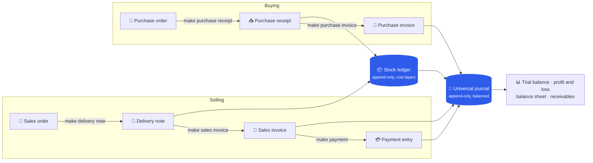
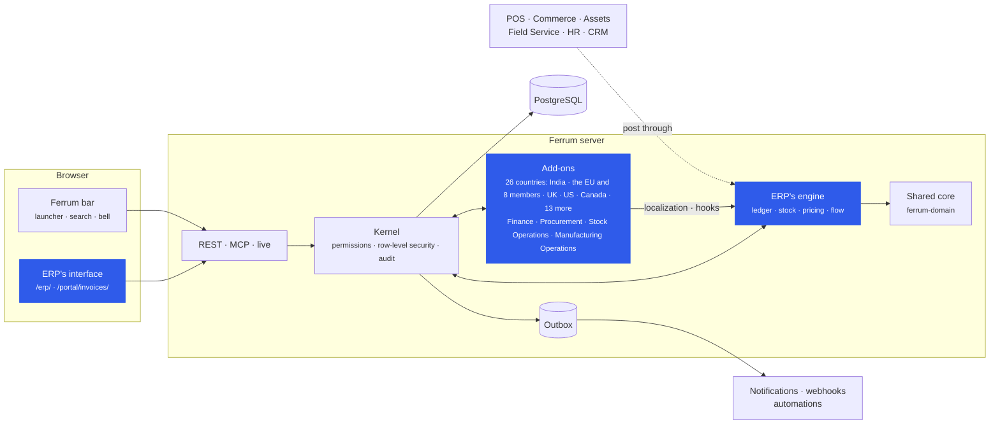
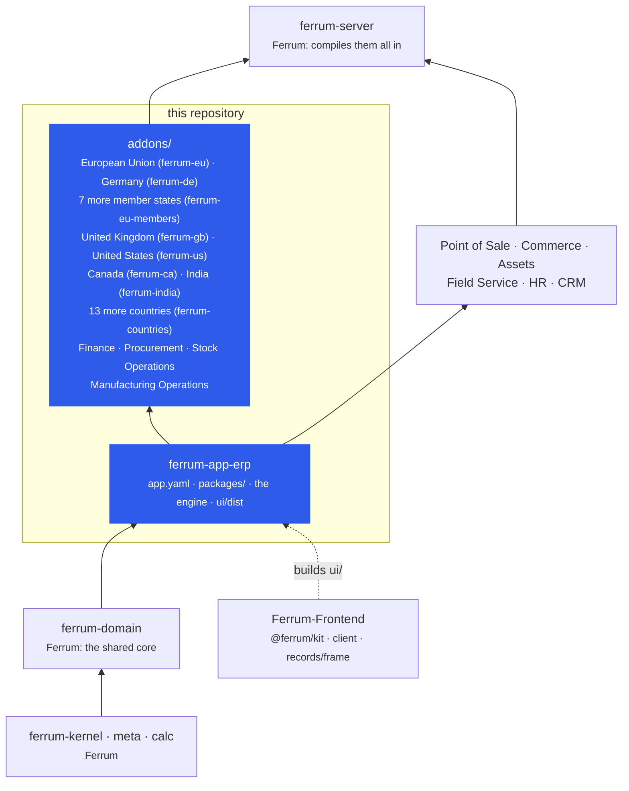

<div align="center">

<picture>
  <source media="(prefers-color-scheme: dark)" srcset="docs/assets/banner-dark.svg">
  
</picture>

[](https://github.com/CBFerrum/ferrum-app-erp/actions/workflows/ci.yml)      

**A native app for [Ferrum](https://github.com/CBFerrum/Ferrum), the open-source, AI-first business platform.**

[Overview](#overview) · [Modules](#modules) · [Countries](#every-country-as-an-add-on) · [Screenshots](#screenshots) · [How it works](#how-it-works) · [Repository](#this-repository) · [Install](#install) · [Develop](#develop) · [Changelog](#changelog)

</div>

---

## Overview

Ferrum ERP is accounting, selling, buying, stock and manufacturing on one universal journal that
is append-only and balanced in the database. Documents carry exact tax maths, stock moves through
an append-only ledger with moving-average and FIFO cost layers (a backdated entry posts forward;
nothing is ever reposted), and every figure the reports show comes from the same ledger. Its
add-ons bring budgets and bank reconciliation, procurement, stock operations and manufacturing
operations. A country's taxes and rules are an add-on too, on one localization seam, and 26 are
built: India's GST with e-invoices and e-way bills, the European Union's VAT with eight member
states' e-invoicing and invoice rules, the United Kingdom's VAT with Making Tax Digital, sales and
use tax across the United States, Canada's GST/HST, PST and QST, and thirteen more countries on
one VAT/GST engine, six of them with e-invoices. Point of Sale, Commerce, Assets, Field Service, HR
and CRM build on its engine.

| At a glance | |
|---|---|
| 📦 Version | `0.5.0`, with each add-on's own version in [the add-ons table](#add-ons) |
| 🧱 Platform | Ferrum `>=0.3.1, <0.4` |
| 🖥️ Interface | its own, at `/erp/`: bank reconciliation, applying payments, the financial statements, accounts today and exchange revaluation hand-crafted, the rest in the records frame; and the portal's invoices at `/portal/invoices/` |
| 🗃️ Packages | accounting, selling, buying, inventory, manufacturing (`packages/`) |
| 🧩 Add-ons | Finance, Procurement, Stock Operations and Manufacturing Operations, and every country's (`addons/`) |
| 🌍 Countries | 26 on the localization seam: India, the European Union and eight of its members, the United Kingdom, the United States, Canada, and thirteen more in South East Asia, the Gulf, Oceania, East Asia and Mexico; next, Croatia, Greece and Hungary ([localization.md](https://github.com/CBFerrum/Ferrum/blob/main/docs/plan/localization.md)) |
| 🔌 Built on by | Point of Sale, Commerce, Assets, Field Service, HR and CRM |
| 👥 Roles | Accounts, Sales, Purchase, Stock and Manufacturing managers and users |

> [!NOTE]
> Everything ERP is lives here: its manifest, interface, packages, engine and add-ons. The
> platform keeps only what every app shares (`ferrum-domain`: helpers, the report framework,
> document helpers and the shared packages), and the apps that post to the books or move stock
> call this crate's `ledger`, `stock`, `pricing` and `flow`.

## Modules

| | Module | What it does | Reports |
|---|---|---|---|
| 📒 | **Accounting** | the universal journal (append-only, balanced in the database), fiscal years, cost centers, accounts and tax templates, journal and payment entries with open-item allocation, period close | trial balance, general ledger, profit and loss, balance sheet, cash flow, receivables, payables, and for a group of companies a consolidated trial balance and statements, with non-controlling interests |
| 🧾 | **Selling** | sales orders, delivery notes and invoices with exact tax maths, pricing rules, receivables | receivables, sales register |
| 🛒 | **Buying** | purchase orders, receipts and supplier invoices with three-way matching against orders and receipts | payables, purchase register |
| 📦 | **Inventory** | warehouses and stock entries on an append-only stock ledger with moving-average and FIFO cost layers | stock balance, stock ledger |
| 🏭 | **Manufacturing** | multi-level bills of materials with revisions, work orders with actual costing, an MRP run that proposes purchases and production | stock balance |

### Add-ons

| | Add-on | Version | What it adds |
|---|---|---|---|
| 🇪🇺 | **European Union** (`ferrum-eu`) | `0.1.6` | EU VAT for a company in a member state: home rates, intra-Community supplies and reverse charge with VAT numbers confirmed in VIES, the One-Stop Shop for sales to consumers elsewhere in the EU, exports and acquisitions; rates from the Commission's TEDB; EN 16931 e-invoices (Peppol BIS Billing 3.0) handed to the company's Peppol access point; the EC sales list and the OSS return |
| 🇩🇪 | **Germany** (`ferrum-de`, on the EU's) | `0.1.0` | XRechnung 3.0 e-invoices checked against KoSIT's rules (a public buyer's Leitweg-ID, a valid IBAN, both electronic addresses), small businesses (§ 19 UStG) invoicing without VAT, and the domestic reverse charge (§ 13b UStG) |
| 🇪🇺 | **Belgium, Italy, Poland, Romania, Spain, France, Portugal** (`ferrum-eu-members`, on the EU's) | `0.1.0`–`0.1.1` | Each its own app: what the country's law asks of invoices (e-invoices through its network, chained records or certified software) and what it adds to the EU's VAT at home (below) |
| 🇬🇧 | **United Kingdom** (`ferrum-gb`) | `0.1.0` | UK VAT (20%, 5%, zero-rated, exempt), the construction industry's reverse charge (CIS), exports and services abroad, reverse-charged services from abroad, VAT numbers checked by HMRC's check digits, and VAT returns (the nine boxes) filed through HMRC's Making Tax Digital API |
| 🇺🇸 | **United States** (`ferrum-us`) | `0.1.0` | Sales tax by destination (by origin within origin-based states) at the ZIP code's combined rate from the states' rate tables, only where the company is registered; marketplace facilitators, exemption certificates and product taxability by state; use tax on untaxed purchases; sales reported to Avalara AvaTax; sales tax by jurisdiction, economic nexus and Forms 1099 reports |
| 🌏 | **Thirteen more countries** (`ferrum-countries`) | `0.1.0`–`0.1.1` | Singapore, Malaysia, Indonesia, Thailand, the Philippines, Vietnam, Saudi Arabia, the UAE, Australia, New Zealand, Japan, Mexico and China: each its own app on one VAT/GST engine, with its dated rates, exports zero-rated, input tax recovered where it is recoverable, services from abroad reverse-charged where the country says, its registration number's check and its return; e-invoices sent on submit in six of them (below) |
| 🇨🇦 | **Canada** (`ferrum-ca`) | `0.1.0` | GST/HST, PST/RST and QST by province of supply (goods where delivered, services by the customer's address) with the CRA's dated rates, zero-rated and exempt supplies, exports, input tax credits, and the GST/HST (GST34) and QST returns |
| 🇮🇳 | **India** (`ferrum-india`) | `0.2.2` | GSTIN validation, place of supply, CGST + SGST or IGST chosen for you, HSN/SAC on lines, reverse charge on purchases (RCM), GST e-invoices (IRN, signed QR) and e-way bills through the IRP |
| 💰 | **Finance** | `0.3.2` | budgets, bank reconciliation (a workbench with exact-match suggestions), payment allocation, exchange revaluation, a finance overview, period closing, dunning, subscriptions and payment terms |
| 📋 | **Procurement** | `0.1.3` | material requests, requests for quotation, supplier quotations and scorecards |
| 🏷️ | **Stock Operations** | `0.1.1` | stock reconciliation, landed costs, pick lists, packing, quality inspection, item variants and product bundles |
| ⚙️ | **Manufacturing Operations** | `0.1.1` | workstations, operations, routings, job cards, production planning and subcontracting |
| 🏭 | **Warehouse Management** | `0.2.1` | bins, positions by lot and owner, receiving to returns, people and robots on one task list, never a second balance |
| 🛠️ | **Manufacturing Execution** | `0.2.1` | release gates, an operator's terminal, lot genealogy and OEE on work orders |
| ✅ | **Quality** | `0.1.0` | holds that stop stock everywhere it could go, nonconformances and corrective action |

<details>
<summary><b>The member states of <code>ferrum-eu-members</code></b></summary>

| | Country | What the law asks | What ERP does | At home |
|---|---|---|---|---|
| 🇧🇪 | Belgium | Peppol between Belgian businesses (since 1 January 2026) | sends each invoice to a Belgian business through the EU's Peppol hand-over on submit, refusing one without both parties' Peppol IDs; enterprise numbers (KBO/BCE) checked and used as 0208 IDs | the small business franchise (article 56bis) and the contractors' reverse charge, in French and Dutch |
| 🇮🇹 | Italy | FatturaPA through SDI (since 2019) | writes FPR12 (schema 1.2.3) with the Natura of lines without VAT and the €2 virtual stamp duty, queued for the company's SDI channel; SDI's receipts recorded; a delivered invoice is corrected by a credit note | the regime forfettario (RF19, N2.2) and the domestic reverse charge |
| 🇵🇱 | Poland | structured invoices through KSeF (since 2026) | writes FA(3) with its rate codes, queued for the company's KSeF channel; KSeF numbers recorded, and corrections cite them | the small business exemption (article 113) and the domestic reverse charge |
| 🇷🇴 | Romania | e-Factura between businesses (since 2024) | uploads CIUS-RO over the company's own OAuth connection to ANAF and follows ANAF's verdict; a validated invoice is corrected by a storno | the small business exemption (article 310) and the domestic reverse charge (article 331) |
| 🇪🇸 | Spain | VERI\*FACTU records from certified software (from 2027) | gives each invoice its record, chained to the last by AEAT's SHA-256 fingerprint, and the verification QR code; sends the records to AEAT when the company uses VERI\*FACTU | the recargo de equivalencia; the Canary Islands, Ceuta and Melilla outside the VAT area |
| 🇫🇷 | France | e-invoices through a plateforme agréée and e-reporting (since September 2026, every business by September 2027) | queues EN 16931 invoices with both parties' SIRENs for the company's platform and records its statuses; an e-invoice is corrected by an avoir; reports the other sales by day and rate | the franchise en base (article 293 B), the construction reverse charge (283-2 nonies) and the invoice's mandatory mentions |
| 🇵🇹 | Portugal | invoices from certified software | numbers each invoice in a series communicated to the AT with its ATCUD, signs it over the series' previous signature with the producer's key ([set on the server](https://github.com/CBFerrum/Ferrum/blob/main/docs/operations.md#portugal-certified-invoices)) and prints the QR code | the small business exemption (article 53) and the construction reverse charge |

</details>

<details>
<summary><b>The thirteen countries of <code>ferrum-countries</code></b></summary>

| | Country | Tax | Return | E-invoices |
|---|---|---|---|---|
| 🇸🇬 | Singapore | GST 9% (8% in 2023, 7% before), the reverse charge for RC businesses | GST F5 | PINT SG through InvoiceNow (UEN) |
| 🇲🇾 | Malaysia | sales tax 10% and 5%, service tax 8% and 6%, not recovered; service tax on imported services | SST-02 | MyInvois through LHDN (UBL JSON) |
| 🇮🇩 | Indonesia | PPN 12% on 11/12 of the price, luxury goods at 12%; the 16-digit NPWP | SPT Masa PPN | — |
| 🇹🇭 | Thailand | VAT 7%; the 13-digit tax ID's check digit | PP.30 | — |
| 🇵🇭 | The Philippines | VAT 12% | 2550Q | — |
| 🇻🇳 | Vietnam | VAT 10%, 5% and the temporary 8% | 01/GTGT | — |
| 🇸🇦 | Saudi Arabia | VAT 15% (5% before July 2020) | ZATCA's VAT return | — |
| 🇦🇪 | The United Arab Emirates | VAT 5% | VAT 201, by emirate | PINT AE (the TIN from the TRN) |
| 🇦🇺 | Australia | GST 10%, GST-free and input-taxed supplies; the ABN's check | the BAS's GST labels | PINT A-NZ (ABN) |
| 🇳🇿 | New Zealand | GST 15%; the IRD number's check | GST101A | PINT A-NZ (NZBN) |
| 🇯🇵 | Japan | consumption tax 10% and the reduced 8%, once per rate per invoice (qualified invoices); the T-number | national and local parts | JP PINT (T-number) |
| 🇲🇽 | Mexico | IVA 16%, the border regions' 8%, 0% and exempt; the RFC | IVA, on a cash basis | — |
| 🇨🇳 | China | VAT 13%, 9% and 6%; small-scale taxpayers' 1% without input credit; the unified social credit code | — | — |

</details>

### Every country as an add-on

The engine knows no country. A country's add-on brings the fields it needs through its package
(prefixed with its code, such as `in_gstin`) and plugs its rules into one seam,
`ferrum_app_erp::localization`. Its rules act only where its package is installed and only for
companies of its country, so one workspace can keep companies in several countries.

| The seam | When it runs | India | European Union |
|---|---|---|---|
| `determine` | inside `pricing::calculate`, before prices and taxes: ERP's documents, CRM's quotations, POS's sales and Commerce's carts alike | the GST template for the place of supply | home, intra-EU, One-Stop Shop, export or reverse charge, from the parties' countries and VAT numbers |
| `line_rates` | after an item's own rates, line by line | — | the destination country's rate for each line (from TEDB, by CN code) |
| `check` | before a priced document is submitted | HSN/SAC codes on outward supplies | the company's VAT number, and the customer's confirmed in VIES before a supply without VAT |
| `setup_company` | after a new company's chart of accounts | GST accounts and tax templates | VAT accounts for a company in a member state |

A member state's add-on builds on the EU's: Germany's (`ferrum-de`) adds XRechnung, and
`ferrum-eu-members` brings Belgium, Italy, Poland, Romania and France, each with its e-invoicing
network, and Spain and Portugal, whose invoices form chained records, on top of the EU's VAT and
its Peppol hand-over.
E-invoices, returns, legal print content and withheld taxes use what the platform already has:
hooks and the outbox, report sources, print formats and deducted tax rows. How each region's taxes
map onto the seam is in [the plan](https://github.com/CBFerrum/Ferrum/blob/main/docs/plan/erp-repo.md#every-country-as-an-add-on).

## Screenshots

<picture>
  <source media="(prefers-color-scheme: dark)" srcset="docs/assets/erp-home-dark.webp">
  
</picture>
<p align="center"><sub>ERP's home: its modules and their add-ons, what is assigned to you, recent records.</sub></p>

<table>
<tr>
<td width="50%">
<picture>
  <source media="(prefers-color-scheme: dark)" srcset="docs/assets/erp-invoice-dark.webp">
  
</picture>
<p align="center"><sub>A submitted invoice: payment, credit note, GST e-invoice and e-way bill, print, email.</sub></p>
</td>
<td width="50%">
<picture>
  <source media="(prefers-color-scheme: dark)" srcset="docs/assets/erp-balance-sheet-dark.webp">
  
</picture>
<p align="center"><sub>The balance sheet, straight from the ledger.</sub></p>
</td>
</tr>
</table>

> [!TIP]
> The screenshots follow your GitHub theme: switch between light and dark to see both.

## How it works

### Documents and the ledgers



### Inside Ferrum



Everything ERP adds is ordinary Ferrum metadata and Rust: its records get lists, forms, search,
permissions, an audit trail, exports and the REST and MCP APIs for free, so AI agents work with
them under the same rules as people.

Apps that post through the engine rely on [its contract](docs/contracts.md): each operation runs
in the caller's transaction, appends rather than changes, says what it refuses, and whether
calling it twice does it twice.

## This repository



Each arrow points from a crate to what builds on it, so nothing below ERP depends on it.

| Stage | What | Status |
|---|---|---|
| 1 | The app and its interface: manifests and `ui/`, compiled into this crate | ✅ built |
| 2 | The add-ons: Finance, Procurement, Stock Operations, Manufacturing Operations | ✅ built |
| 3 | The packages and the engine, India as an add-on on the localization seam, and the apps that build on them | ✅ built |

## Install

ERP ships in the official Ferrum server image and is recorded as installed in every workspace
that has accounting; India and the other add-ons install from **Apps** (`/store/`) in Ferrum, where
an administrator also upgrades ERP when a new version arrives. Everything it adds is available to AI
agents over Ferrum's MCP server, within each person's permissions.

## Develop

Clone it next to the platform:

```text
work/
├── ferrum/            https://github.com/CBFerrum/Ferrum (with Ferrum-Frontend cloned into ferrum/web)
└── ferrum-app-erp/
```

Point the platform dependencies at your checkout (this file is git-ignored):

```toml
# .cargo/config.toml
[patch."https://github.com/CBFerrum/Ferrum"]
ferrum-kernel = { path = "../ferrum/crates/kernel" }
ferrum-meta = { path = "../ferrum/crates/meta" }
ferrum-domain = { path = "../ferrum/crates/domain" }
ferrum-calc = { path = "../ferrum/crates/calc" }
ferrum-apps = { path = "../ferrum/crates/apps" }
ferrum-plugins = { path = "../ferrum/crates/plugins" }
```

Apps that build on ERP (Point of Sale, Commerce, Assets, Field Service, HR, CRM and the store)
take this repository from GitHub; to work on both at once, clone it beside them and add
`[patch."https://github.com/CBFerrum/ferrum-app-erp"]` with `ferrum-app-erp = { path = "../ferrum-app-erp" }`.

The tests need PostgreSQL with an ordinary (non-superuser) role, so row-level security applies,
and a database for ERP's and each add-on's (they reset it first):

```bash
createuser ferrum --pwprompt
for db in erp eu de eu_members gb ca us countries finance finance_books procurement stock_ops mfg_ops; do
  createdb -O ferrum ferrum_${db}_test
done
cargo test --workspace
```

`FERRUM_<NAME>_TEST_DATABASE_URL` overrides each one's URL (`FERRUM_ERP_…`, `FERRUM_EU_MEMBERS_…`,
`FERRUM_STOCK_OPS_…` and so on, the database's name in capitals). ERP's end-to-end test (`tests/erp_it.rs`)
walks a GST-registered company through opening stock, procure-to-pay, order-to-cash with a fake
IRP, payments, credit notes, manufacturing, MRP, period closing and concurrent stock issues, and a
company outside India that gets none of India's rules.

The interface lives in `ui/` and builds with Ferrum-Frontend's packages:

```bash
cd ui
npm run build      # ui/dist, checked against the size budget
npm test
```

With a development server started with `FERRUM_DEV_UI=1`, `ferrum-app dev --ui` serves the pages
from Vite behind the real bar and session, with hot reload.

### Project layout

```text
app.yaml         ERP's manifest: its packages, interface, launcher entry and portal page
packages/        accounting, buying, inventory, manufacturing, selling
src/             the engine (ledger, stock, pricing, trade, manufacturing, set-up, reports,
                 localization), the manifest's entry points and the embedded interface
tests/           the end-to-end scenario against a real PostgreSQL
ui/              ERP's interface (React + Vite), built into ui/dist
addons/          the European Union, Germany, the United Kingdom, the United States, Canada
                 and India (each with its app.yaml); seven more member states (eu-members/)
                 and thirteen more countries (countries/), an app each under apps/; Finance,
                 Procurement, Stock Operations, Manufacturing Operations
CHANGELOG.md     what changed in each version
```

## Changelog

| Version | Highlights |
|---|---|
| **ERP 0.14.8** | Rebuilt with Ferrum-Frontend 63280d3: right to left, pages mirror; the records pages' words in Arabic and Hindi. |
| **ERP 0.14.7** | Rebuilt with Ferrum-Frontend a64416a: a box whose default is 1 shows ticked. |
| **ERP 0.14.6** | Rebuilt with Ferrum-Frontend 922fcfb: action dialogs say every refusal and ask once. |
| **ERP 0.14.5** | Rebuilt with Ferrum-Frontend a76295e: times on a person's own clock when they chose one. |
| **ERP 0.14.4** | Rebuilt with Ferrum-Frontend 24c3951: times on the workspace's clock; drafts headed as drafts. |
| **ERP 0.14.3** | Rebuilt with Ferrum-Frontend bb60115: empty numbers read as the server reads them; settings open as their record. |
| **ERP 0.14.2, Procurement 0.1.3, Finance 0.3.2** | Record pages' actions ask for what they need: the supplier of a supplier quotation and, where an item has no approved supplier, of a purchase order; the warehouses of a stock entry and a work order; who paid or was paid for a bank line's payment entry, and the account of its journal entry. A purchase invoice is not submitted with the placeholder number its draft was made with. |
| **ERP 0.14.1** | Rebuilt with Ferrum-Frontend 00dea07: a workflow state's kept fields are read-only, its needed ones required. |
| **ERP 0.14.0** | A subscription's revenue is earned over the days it pays for, refunds over the days they give back; MRR reads plans as they stood, with expansion, contraction and net revenue retention. |
| **ERP 0.13.0** | A sale to one of the group's companies makes that company's purchase invoice, from the supplier that represents the seller, numbered as the sale, once. |
| **ERP 0.12.0** | Non-controlling interests: a company says how much of it its parent holds, and the consolidated balance sheet and profit and loss split equity and profit between the owners of the parent and the non-controlling interests. A group's cash flow, every flow at the rate of its day, with the effect of exchange rates on cash. |
| **ERP 0.11.0** | A group's books translated as IAS 21 says: assets and liabilities at the closing rate, income, expenses and equity at the rate of their day where the books have one; what that leaves is the foreign currency translation reserve, in equity. |
| **ERP 0.10.2, Finance 0.3.1** | A reversal day left empty is the day after the entry's own, worked out when it is submitted, not while it was a draft. Actions say what they did. |
| **ERP 0.10.1** | Create Standard Chart of Accounts brings an existing company's chart up to the standard one: the accounts it lacks under their standard parents, and the empty default links set. |
| **ERP 0.10.0** | Accruals that reverse themselves: a journal entry marked Reverse It is taken out again on its reversal day (the day after, unless another is chosen), once, by the daily upkeep or at once when the day has come. Deferred Revenue and Expense, a report of every deferred line with what was recognised, what still waits and what recognising through a day would move. Accrued Income (1180) and Accrued Expenses (2160) in the standard chart. |
| **ERP 0.9.0** | Deferred revenue and expense: an invoice line over a service period waits on a deferred account and is recognised by the day, every month and through a day an accountant chooses; cancelling the invoice reverses what was recognised. |
| **ERP 0.8.0, Procurement 0.1.2, Warehouse 0.2.1, Shop Floor 0.2.1** | Your orders on the workspace's portal: the requests for quotation waiting for a supplier's answer, their purchase orders with what was received and billed, printed or in PDF, and the bills ERP holds from them with what is still owed. Interfaces rebuilt with Ferrum-Frontend d4efeca. |
| **India 0.2.2** | E-invoices checked against the IRP's published value rules for every kind ERP builds; CGST and SGST on a supply to another state or an SEZ unit refused before the IRP refuses it, and IGST within the state marked as such. |
| **ERP 0.7.1** | The assistant knows how ERP's records work in its pages (documents' states, what is owed, which reports hold the books' figures, finance books and groups) and suggests five questions to start with. |
| **ERP 0.7.0** | A group's books: a company's parent makes a group, and a consolidated trial balance, profit and loss and balance sheet add up the parent and every company under it in the parent's currency, on the parent's chart. Business within the group is taken out (customers and suppliers that represent its companies, accounts marked Eliminate in Consolidation), and what does not cancel shows as an intercompany difference beside what each pair of companies says they owe each other. One closing rate per company; no minority interest yet. |
| **ERP 0.6.0, Finance 0.3.0** | Finance books, as ERPNext keeps them: IFRS beside local rules, a tax book beside both. An entry with no book is in every book, one with a book adjusts that book alone, receivables and payables are the same in all of them, and every statement, the general ledger and the year-end closing take a book. |
| **ERP 0.5.0, Finance 0.2.0** | The accountant's screens, each with its rules in the server. A bank reconciliation workbench (statement lines beside what the books have, the bank's balance after each, exact matches paired so none is used twice and accepted with one key, the difference always in view, a statement checked before it is imported). Payment allocation: a party's payments, credit notes and journal credits applied to their open invoices in one document, with the exchange gain or loss of each pairing. Comparative profit and loss and balance sheet (up to three earlier periods, by cost centre or project), a cash flow statement that must end where the bank does, and a general ledger that opens a group as every account below it, so a figure opens the entries behind it. Exchange revaluation at a period's end, reversed the day after. A finance overview of what needs attention today. |
| **Portugal 0.1.0** | Portugal in `ferrum-eu-members`: invoices from certified software. Each takes the next number of a series communicated to the AT and its ATCUD, is signed (RSA) over its date, number, total and the series' previous signature, so each series forms a hash chain, and carries the QR code (Portaria 195/2020); NIFs checked; the small business exemption (article 53) and the construction reverse charge. The software producer's key and certificate number are set on the server (`FERRUM_PT_SIGNING_KEY`, `FERRUM_PT_CERTIFICATE`, `FERRUM_PT_KEY_VERSION`); without them, submitting is refused. |
| **Romania 0.1.1** | The connection to ANAF's e-Factura in `ferrum-eu-members`: OAuth sign-in with the company's qualified certificate, its tokens stored encrypted and refreshed; queued CIUS-RO invoices uploaded (test or production), and ANAF asked after each until it accepts it (the signed invoice's download ID recorded) or rejects it (with its errors). With the connection Off, invoices wait for ANAF's answer to be recorded by hand. |
| **Malaysia 0.1.1** | Malaysia's e-invoices through LHDN's MyInvois in `ferrum-countries`: a submitted invoice or credit note as UBL 2.1 JSON with the supplier's TIN, BRN, SST number and MSIC code, submitted with its SHA-256 and followed until LHDN validates it, its UUID, long ID and validation link recorded; cancelled at LHDN within 72 hours, corrected by a credit note after; the general public's and foreign buyers' TINs. With AvaTax or HMRC set to Off, the US and UK add-ons never reach the service, even with the test address override. |
| **Singapore, Australia, New Zealand, Japan, UAE 0.1.1, EU 0.1.6** | Peppol PINT e-invoices in `ferrum-countries`: PINT SG for InvoiceNow, PINT A-NZ, JP PINT and PINT AE, each with its tax scheme, category codes and participants' electronic addresses (UEN, ABN, NZBN, the T-number, the TIN), checked against PINT's rules and sent through the company's Peppol access point on submit, the access point's answer recorded. The EU 0.1.6's UBL writer takes a profile, transaction type and tax scheme. |
| **France 0.1.0** | France in `ferrum-eu-members`, for the e-invoicing reform: invoices to French businesses queued on submit for the company's plateforme agréée as EN 16931 UBL with both parties' SIRENs, the platform's lifecycle statuses recorded, corrections by avoir; e-reporting of the other sales by day and rate; the invoice's mandatory mentions; SIREN, SIRET and VAT number keys checked; the franchise en base (article 293 B) and the construction reverse charge (283-2 nonies). The EU 0.1.5 writes the parties' legal registration identifiers. |

<details>
<summary><b>Earlier releases</b></summary>

| Version | Highlights |
|---|---|
| **Spain 0.1.0** | Spain in `ferrum-eu-members`: VERI\*FACTU invoicing records chained by AEAT's SHA-256 fingerprint (AEAT's test vectors pass), cancellation records, the verification QR code, and records sent to AEAT through the outbox when the company uses VERI\*FACTU; NIFs checked; the recargo de equivalencia; the Canary Islands, Ceuta and Melilla outside the VAT area. |
| **Belgium, Italy, Poland, Romania 0.1.0** | `ferrum-eu-members` on the EU's add-on: Belgium's Peppol between businesses, Italy's FatturaPA through SDI, Poland's FA(3) through KSeF and Romania's CIUS-RO through ANAF's e-Factura, with each country's small business exemption and domestic reverse charge. The EU 0.1.4 writes the parties' country subdivisions. |
| **Thirteen countries 0.1.0** | `ferrum-countries`: Singapore, Malaysia, Indonesia, Thailand, the Philippines, Vietnam, Saudi Arabia, the UAE, Australia, New Zealand, Japan, Mexico and China, each its own app on one VAT/GST engine, with dated rates, its registration number's check and its return. |
| **United States 0.1.0** | The United States' add-on: sales tax by destination at ZIP codes' rates where the company is registered, exemption certificates, marketplace facilitators, product taxability, use tax, AvaTax reporting, and sales tax, economic nexus and Form 1099 reports. |
| **Canada 0.1.0** | Canada's add-on: GST/HST, PST/RST and QST by province of supply with the CRA's dated rates, zero-rated and exempt supplies, exports, input tax credits, and the GST/HST and QST returns. |
| **United Kingdom 0.1.0** | The UK's add-on: UK VAT with the CIS reverse charge, exports and services abroad, and VAT returns filed through HMRC's Making Tax Digital API. The EU 0.1.2 reads TEDB with an updated XML parser (two advisories fixed). |
| **Germany 0.1.0** | Germany's add-on on the EU's: XRechnung 3.0 to KoSIT's rules, small businesses (§ 19 UStG) and the domestic reverse charge (§ 13b UStG). The EU 0.1.1 puts a company's invoice address, contact, IBAN and tax number on its e-invoices. |
| **0.4.0** | The European Union's add-on (`ferrum-eu` 0.1.0): EU VAT with VIES, intra-Community supplies, the One-Stop Shop, exports and acquisitions; rates from TEDB; EN 16931 e-invoices with the Peppol hand-over; the EC sales list and the OSS return. India 0.2.1 follows NIC's reverse-charge rules on e-invoices. |
| **0.3.0** | What every country's rules build on: tax categories and exemption reasons with a tax breakdown per category and rate (EN 16931), taxes per unit, reverse charge, tax rounding line by line, and party and ship-to addresses on documents. India 0.2.0 follows a company's ISO country code and handles reverse-charge purchases. |
| **0.2.0** | ERP's own repository holds all of it: its manifest, interface, packages and engine, which other apps build on, and its add-ons. Countries plug in through `localization`, India first as the add-on `ferrum-india`. Earlier history is in Ferrum and Ferrum-Frontend. |

</details>

Every version is in [CHANGELOG.md](CHANGELOG.md).

## License

[AGPL-3.0-or-later](LICENSE), like the platform. Part of [Ferrum](https://github.com/CBFerrum/Ferrum) ·
[Report an issue](https://github.com/CBFerrum/ferrum-app-erp/issues)
