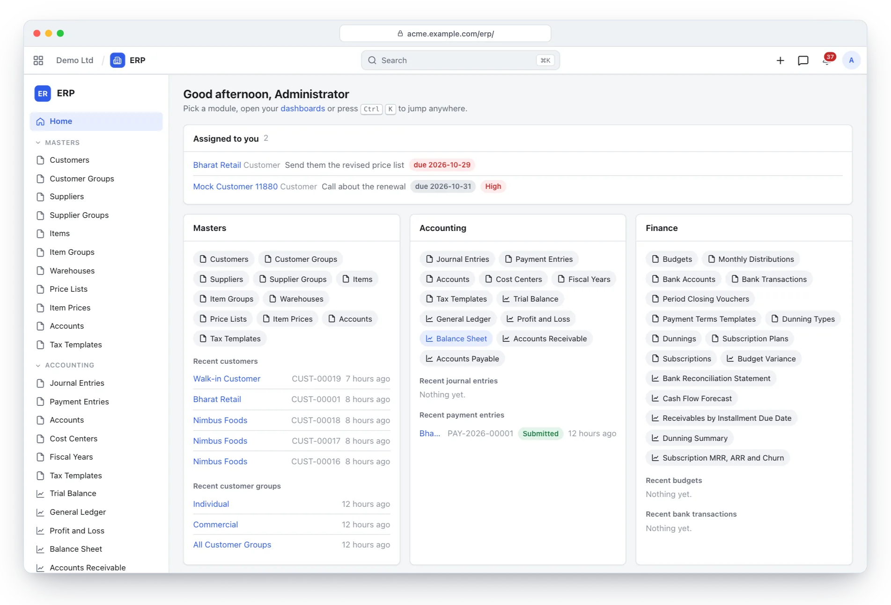
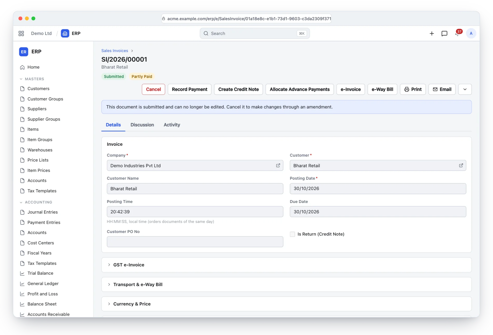
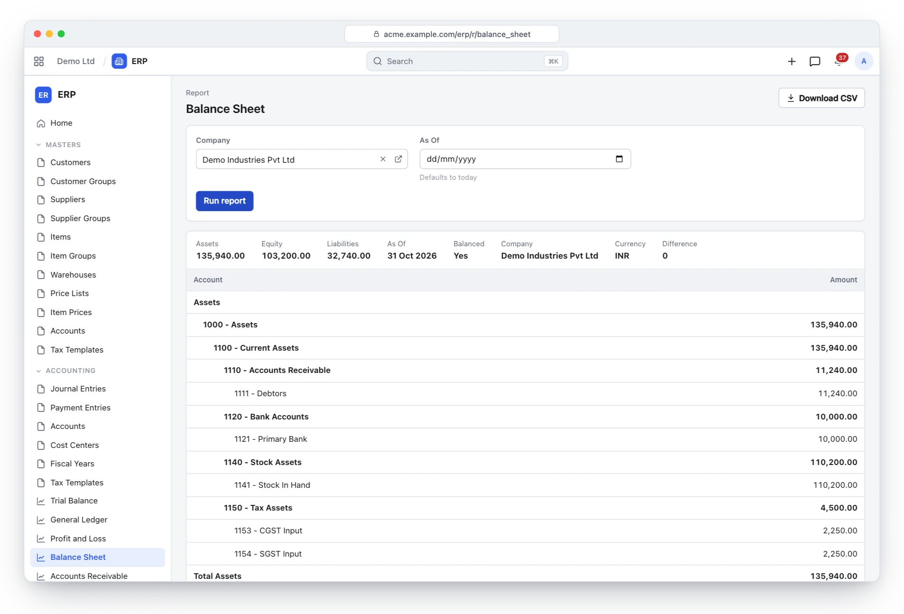
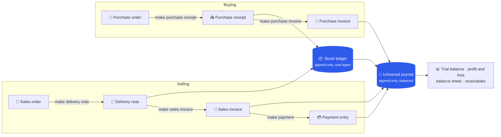
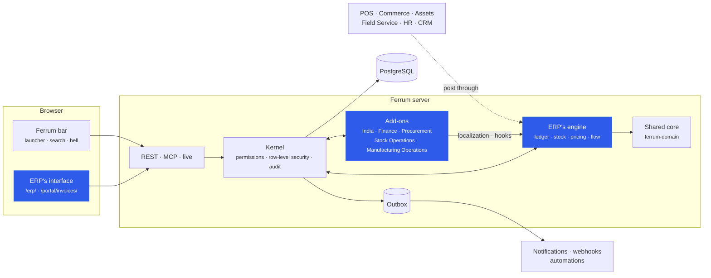
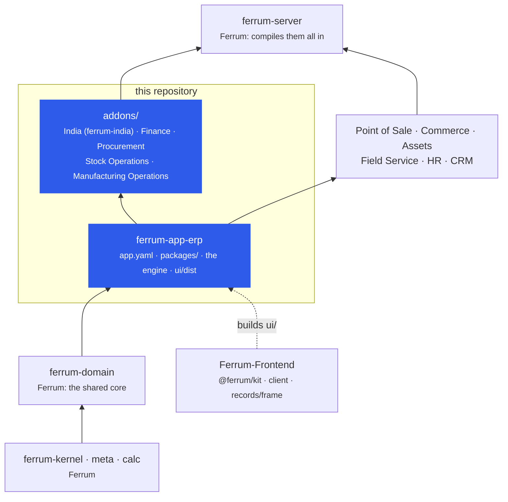

<div align="center">

<picture>
  <source media="(prefers-color-scheme: dark)" srcset="docs/assets/banner-dark.svg">
  
</picture>

[](https://github.com/CBFerrum/ferrum-app-erp/actions/workflows/ci.yml)      

**A native app for [Ferrum](https://github.com/CBFerrum/Ferrum), the open-source, AI-first business platform.**

[Overview](#overview) · [Modules](#modules) · [Countries](#every-country-as-an-add-on) · [Screenshots](#screenshots) · [How it works](#how-it-works) · [Repository](#this-repository) · [Install](#install) · [Develop](#develop) · [Changelog](#changelog)

</div>

---

## Overview

Ferrum ERP is accounting, selling, buying, stock and manufacturing on one universal journal that
is append-only and balanced in the database. Documents carry exact tax maths, stock moves through
an append-only ledger with moving-average and FIFO cost layers (a backdated entry posts forward;
nothing is ever reposted), and every figure the reports show comes from the same ledger. Its
add-ons bring budgets and bank reconciliation, procurement, stock operations and manufacturing
operations. A country's taxes and rules are an add-on too, on one localization seam: India's (GST,
e-invoices and e-way bills) is the first. Point of Sale, Commerce, Assets, Field Service, HR and CRM
build on its engine.

| At a glance | |
|---|---|
| 📦 Version | `0.3.0` (India `0.2.0`, the other add-ons `0.1.1`) |
| 🧱 Platform | Ferrum `>=0.3.1, <0.4` |
| 🖥️ Interface | its own, at `/erp/`, and the portal's invoices at `/portal/invoices/` |
| 🗃️ Packages | accounting, selling, buying, inventory, manufacturing (`packages/`) |
| 🧩 Add-ons | India, Finance, Procurement, Stock Operations, Manufacturing Operations (`addons/`) |
| 🌍 Countries | add-ons on the localization seam: India built, every other country its own add-on |
| 🔌 Built on by | Point of Sale, Commerce, Assets, Field Service, HR and CRM |
| 👥 Roles | Accounts, Sales, Purchase, Stock and Manufacturing managers and users |

> [!NOTE]
> Everything ERP is lives here: its manifest, interface, packages, engine and add-ons. The
> platform keeps only what every app shares (`ferrum-domain`: helpers, the report framework,
> document helpers and the shared packages), and the apps that post to the books or move stock
> call this crate's `ledger`, `stock`, `pricing` and `flow`.

## Modules

| | Module | What it does | Reports |
|---|---|---|---|
| 📒 | **Accounting** | the universal journal (append-only, balanced in the database), fiscal years, cost centers, accounts and tax templates, journal and payment entries with open-item allocation, period close | trial balance, general ledger, profit and loss, balance sheet, receivables, payables |
| 🧾 | **Selling** | sales orders, delivery notes and invoices with exact tax maths, pricing rules, receivables | receivables, sales register |
| 🛒 | **Buying** | purchase orders, receipts and supplier invoices with three-way matching against orders and receipts | payables, purchase register |
| 📦 | **Inventory** | warehouses and stock entries on an append-only stock ledger with moving-average and FIFO cost layers | stock balance, stock ledger |
| 🏭 | **Manufacturing** | multi-level bills of materials with revisions, work orders with actual costing, an MRP run that proposes purchases and production | stock balance |

### Add-ons

| | Add-on | What it adds |
|---|---|---|
| 🇮🇳 | **India** (`ferrum-india`) | GSTIN validation, place of supply, CGST + SGST or IGST chosen for you, HSN/SAC on lines, reverse charge on purchases (RCM), GST e-invoices (IRN, signed QR) and e-way bills through the IRP |
| 💰 | **Finance** | budgets, bank reconciliation, period closing, dunning, subscriptions and payment terms |
| 📋 | **Procurement** | material requests, requests for quotation, supplier quotations and scorecards |
| 🏷️ | **Stock Operations** | stock reconciliation, landed costs, pick lists, packing, quality inspection, item variants and product bundles |
| ⚙️ | **Manufacturing Operations** | workstations, operations, routings, job cards, production planning and subcontracting |

### Every country as an add-on

The engine knows no country. A country's add-on brings the fields it needs through its package
(prefixed with its code, such as `in_gstin`) and plugs its rules into one seam,
`ferrum_app_erp::localization`. Its rules act only where its package is installed and only for
companies of its country, so one workspace can keep companies in several countries.

| The seam | When it runs | India |
|---|---|---|
| `determine` | inside `pricing::calculate`, before prices and taxes: ERP's documents, CRM's quotations, POS's sales and Commerce's carts alike | the GST template for the place of supply |
| `check` | before a priced document is submitted | HSN/SAC codes on outward supplies |
| `setup_company` | after a new company's chart of accounts | GST accounts and tax templates |

E-invoices, returns, legal print content and withheld taxes use what the platform already has:
hooks and the outbox, report sources, print formats and deducted tax rows. How each region's taxes
map onto the seam is in [the plan](https://github.com/CBFerrum/Ferrum/blob/main/docs/plan/erp-repo.md#every-country-as-an-add-on).

## Screenshots

<picture>
  <source media="(prefers-color-scheme: dark)" srcset="docs/assets/erp-home-dark.webp">
  
</picture>
<p align="center"><sub>ERP's home: its modules and their add-ons, what is assigned to you, recent records.</sub></p>

<table>
<tr>
<td width="50%">
<picture>
  <source media="(prefers-color-scheme: dark)" srcset="docs/assets/erp-invoice-dark.webp">
  
</picture>
<p align="center"><sub>A submitted invoice: payment, credit note, GST e-invoice and e-way bill, print, email.</sub></p>
</td>
<td width="50%">
<picture>
  <source media="(prefers-color-scheme: dark)" srcset="docs/assets/erp-balance-sheet-dark.webp">
  
</picture>
<p align="center"><sub>The balance sheet, straight from the ledger.</sub></p>
</td>
</tr>
</table>

> [!TIP]
> The screenshots follow your GitHub theme: switch between light and dark to see both.

## How it works

### Documents and the ledgers



### Inside Ferrum



Everything ERP adds is ordinary Ferrum metadata and Rust: its records get lists, forms, search,
permissions, an audit trail, exports and the REST and MCP APIs for free, so AI agents work with
them under the same rules as people.

## This repository



Each arrow points from a crate to what builds on it, so nothing below ERP depends on it.

| Stage | What | Status |
|---|---|---|
| 1 | The app and its interface: manifests and `ui/`, compiled into this crate | ✅ built |
| 2 | The add-ons: Finance, Procurement, Stock Operations, Manufacturing Operations | ✅ built |
| 3 | The packages and the engine, India as an add-on on the localization seam, and the apps that build on them | ✅ built |

## Install

ERP ships in the official Ferrum server image and is recorded as installed in every workspace
that has accounting; India and the other add-ons install from **Apps** (`/store/`) in Ferrum, where
an administrator also upgrades ERP when a new version arrives. Everything it adds is available to AI
agents over Ferrum's MCP server, within each person's permissions.

## Develop

Clone it next to the platform:

```text
work/
├── ferrum/            https://github.com/CBFerrum/Ferrum (with Ferrum-Frontend cloned into ferrum/web)
└── ferrum-app-erp/
```

Point the platform dependencies at your checkout (this file is git-ignored):

```toml
# .cargo/config.toml
[patch."https://github.com/CBFerrum/Ferrum"]
ferrum-kernel = { path = "../ferrum/crates/kernel" }
ferrum-meta = { path = "../ferrum/crates/meta" }
ferrum-domain = { path = "../ferrum/crates/domain" }
ferrum-calc = { path = "../ferrum/crates/calc" }
ferrum-apps = { path = "../ferrum/crates/apps" }
ferrum-plugins = { path = "../ferrum/crates/plugins" }
```

Apps that build on ERP (Point of Sale, Commerce, Assets, Field Service, HR, CRM and the store)
take this repository from GitHub; to work on both at once, clone it beside them and add
`[patch."https://github.com/CBFerrum/ferrum-app-erp"]` with `ferrum-app-erp = { path = "../ferrum-app-erp" }`.

The tests need PostgreSQL with an ordinary (non-superuser) role, so row-level security applies,
and a database for ERP's and each add-on's (they reset it first):

```bash
createuser ferrum --pwprompt
for db in erp finance procurement stock_ops mfg_ops; do createdb -O ferrum ferrum_${db}_test; done
cargo test --workspace
```

`FERRUM_ERP_TEST_DATABASE_URL`, `FERRUM_FINANCE_TEST_DATABASE_URL`,
`FERRUM_PROCUREMENT_TEST_DATABASE_URL`, `FERRUM_STOCK_OPS_TEST_DATABASE_URL` and
`FERRUM_MFG_OPS_TEST_DATABASE_URL` override the URLs. ERP's end-to-end test (`tests/erp_it.rs`)
walks a GST-registered company through opening stock, procure-to-pay, order-to-cash with a fake
IRP, payments, credit notes, manufacturing, MRP, period closing and concurrent stock issues, and a
company outside India that gets none of India's rules.

The interface lives in `ui/` and builds with Ferrum-Frontend's packages:

```bash
cd ui
npm run build      # ui/dist, checked against the size budget
npm test
```

With a development server started with `FERRUM_DEV_UI=1`, `ferrum-app dev --ui` serves the pages
from Vite behind the real bar and session, with hot reload.

### Project layout

```text
app.yaml         ERP's manifest: its packages, interface, launcher entry and portal page
packages/        accounting, buying, inventory, manufacturing, selling
src/             the engine (ledger, stock, pricing, trade, manufacturing, set-up, reports,
                 localization), the manifest's entry points and the embedded interface
tests/           the end-to-end scenario against a real PostgreSQL
ui/              ERP's interface (React + Vite), built into ui/dist
addons/          India (with its app.yaml), Finance, Procurement, Stock Operations,
                 Manufacturing Operations
CHANGELOG.md     what changed in each version
```

## Changelog

| Version | Highlights |
|---|---|
| **0.3.0** | What every country's rules build on: tax categories and exemption reasons with a tax breakdown per category and rate (EN 16931), taxes per unit, reverse charge, tax rounding line by line, and party and ship-to addresses on documents. India 0.2.0 follows a company's ISO country code and handles reverse-charge purchases. |
| **0.2.0** | ERP's own repository holds all of it: its manifest, interface, packages and engine, which other apps build on, and its add-ons. Countries plug in through `localization`, India first as the add-on `ferrum-india`. Earlier history is in Ferrum and Ferrum-Frontend. |

Every version is in [CHANGELOG.md](CHANGELOG.md).

## License

[AGPL-3.0-or-later](LICENSE), like the platform. Part of [Ferrum](https://github.com/CBFerrum/Ferrum) ·
[Report an issue](https://github.com/CBFerrum/ferrum-app-erp/issues)
